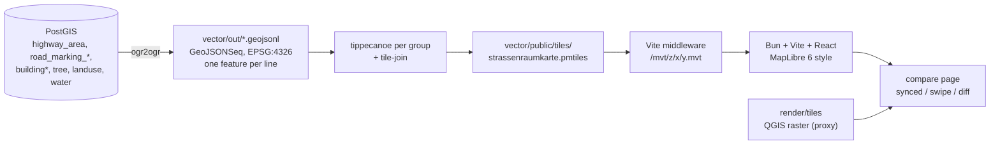

## Context (what exists today)

- Pipeline: OSM PBF → osm2pgsql flex → ~40 PostGIS SQL steps → PyQGIS metatile renderer → raster XYZ at `render/tiles/{z}/{x}/{y}.jpg`, **z15–z20**.
- Styling lives entirely in `style/strassenraumkarte.qgz`: 64 unique layers, ~812 renderer rules, **1058 SimpleLine / 835 SimpleFill / 803 SimpleMarker / 185 SvgMarker / 133 RasterFill**, **137 enabled dropShadow/innerShadow/outerGlow**, 7 Gradient/Shapeburst fills, **0 geometry generators**.
- Widths are ground metres: carriageway polygons bake width via `ST_Buffer(metres(...))`; lanes/markings keep `width` as a metre attribute; QGIS scales symbols with `@mercator_scale`.
- **Prep done (2026-08):** `vector/` Bun package with export → tippecanoe → `.pmtiles` and a MapLibre geometry-type preview. See [Prep tooling notes](#prep-tooling-notes-landed) below.
- Installed: `tippecanoe 2.79`, `tile-join`, `ogr2ogr` (GDAL 3.13), `bun`, `node`. Current npm in `vector/`: `maplibre-gl@6.0.0`, `pmtiles@4.4.1` (react-map-gl still planned for compare UI).

## Target architecture



New top-level folder `vector/` — one Bun package, clean separation from the bash/Python pipeline.

```
vector/
  package.json  vite.config.ts  tsconfig.app.json  tsconfig.scripts.json
  layers.ts                 # single source of truth: table, columns, filter, zoom range, paint kind
  scripts/export.ts         # PostGIS -> GeoJSONSeq via ogr2ogr
  scripts/build-tiles.ts    # tippecanoe per group + tile-join -> .pmtiles
  scripts/tile-report.ts    # group + final archive sizes
  scripts/inspect-pmtiles.ts
  scripts/verify-preview.ts # Playwright smoke (WebGL + idle)
  src/style/basic.ts        # prep geometry-type style
  src/App.tsx               # MapLibre preview
  out/  public/tiles/       # gitignored artefacts
```

## Prep tooling notes (landed)

Verified on the Berlin Docker DB (`localhost:5433` / `strassenraumkarte`) with the Neukölln extract.

**Export**

- `ogr2ogr -f GeoJSONSeq` with `ST_Transform(ST_SetSRID(geom, 3857), 4326)` — several tables lack SRID metadata; always set 3857 before transform.
- Connection: `DB_*` / `PGPASSWORD` matching `data/db_config.sh` (port **5433**).
- Slim attributes for now (`osm_id` / `layer` / `name` where useful). Expand columns when QGIS style lands.
- There is no separate `highway_path` table; path-like surfaces live in `highway_area` (`area:highway` = footway/path/cycleway/…).

**Tippecanoe**

- Groups + zoom ranges as planned; flags `-r1 --no-tiny-polygon-reduction --simplification=2 --preserve-input-order` (prep also used `--no-tile-compression` for easier debugging — reconsider for production size).
- Named layers via `-Lname:file.geojsonl`, then `tile-join -f -o public/tiles/strassenraumkarte.pmtiles`.
- Measured (Berlin extract, uncompressed intermediates): ground ~0.8 MiB, streets ~1.8 MiB, buildings ~18.6 MiB, detail ~3.6 MiB, labels ~0.3 MiB → joined archive **~13 MiB**.

**MapLibre 6 + Vite (important)**

1. **Do not rely on `addProtocol('pmtiles')` in Vite/MapLibre 6 for tile bytes.** Tile JSON can load on the main thread, but MVT fetches run in the **web worker**, where the custom protocol is not available — tiles stay `loading` forever. Prep serves HTTP `/mvt/{z}/{x}/{y}.mvt` from the archive via a Vite middleware (`pmtiles` `getZxy`). Keep the `.pmtiles` file as the artefact; HTTP is the browser delivery path for now.
2. **Pin the worker:** Vite’s dep optimizer breaks the default worker URL (`maplibre-gl-worker.mjs` missing under `.vite/deps`). Call `setWorkerUrl(import 'maplibre-gl/dist/maplibre-gl-worker.mjs?url')` and **`optimizeDeps.exclude: ['maplibre-gl']`**.
3. **Named imports** from `maplibre-gl` (no default export in the ESM build).
4. Bind `Protocol.tile` if/when using the protocol for metadata (`this` is required); prefer `{ metadata: true }` so TileJSON includes `vector_layers`.
5. Trees/detail layers start at **z17** — at z16 only fills/lines from ground/streets/buildings show (expected).

**Commands**

```bash
cd vector
bun install
PGPASSWORD=… bun run pipeline   # export + tiles + report
bun run dev                      # http://127.0.0.1:5177
bun run scripts/verify-preview.ts
```

## Key technical decisions

**Metre → pixel widths.** MapLibre paints in CSS px with 512 px tiles, so `px = metres * 2^zoom / (78271.51696 * cos φ)`. Because that is exactly base-2 exponential in zoom, one helper reproduces QGIS ground-metre sizing exactly:

```ts
export const metresToPixels = (m: number | Expression, lat = 52.48) => [
  'interpolate', ['exponential', 2], ['zoom'],
  15, ['*', m, 2 ** 15 / (78271.51696 * Math.cos(lat * Math.PI / 180))],
  20, ['*', m, 2 ** 20 / (78271.51696 * Math.cos(lat * Math.PI / 180))],
]
```

This replaces every `@mercator_scale * "width"` data-defined property.

**Tippecanoe.** Vector tiles are resolution-independent, so do **not** generate to z20. Build per layer group with its own zoom range, then merge with `tile-join`:

- ground/landuse/water: `-Z15 -z16`
- highway_area / service / path: `-Z15 -z17`
- buildings + building_lines: `-Z15 -z17`
- road markings, separation, tactile paving, trees: `-Z17 -z18`

Overzoom to 20 in the style (`source.maxzoom`). Flags: `-r1 --no-tiny-polygon-reduction --simplification=2 --preserve-input-order`, deliberately **not** `--drop-densest-as-needed` (detail is the point). Size control comes from attribute slimming in `layers.ts` (export only styled columns) and from group zoom ranges. `scripts/tile-report.ts` prints per-layer bytes per zoom so the flags are tuned against measurements, not guesses.

**Effects (the hard part, driven by [research/maplibre-special-case-styling](research/maplibre-special-case-styling/summary.md)).** A `src/style/effects.ts` module with three primitives, applied to the ~137 QGIS effect uses:

- `dropShadow(fillLayer, {blurM, offsetM, angle, color, opacity})` → duplicate fill below with `fill-translate` + `fill-opacity`, plus a `line` layer with matched `line-width`/`line-blur` for the soft edge (chapter 1: drive width and blur from the *same* interpolate expression).
- `innerShadow(polygonLayer, …)` → inward `line` layer with negative `line-offset` (half width) + `line-blur`. Covers the `z14`–`z20` highway blur stack, `water body`, `sandpit`.
- `outerGlow(...)` → 2 stacked blurred outline lines, colours slightly lighter than the fill, opacity ramped on the same zoom stops.

Gradient/Shapeburst (roof shape, water depth) → stepped concentric blurred lines in v1; accepted as non-1:1.

**Graphics — base shapes first, images only where unavoidable** (per [research/maplibre-ad-hoc-image-loading](research/maplibre-ad-hoc-image-loading/summary.md)):

1. Replace with primitives wherever possible: tree crowns → `circle` (radius from `diameter_crown` via `metresToPixels`); trunk, bollards, simple markers → `circle`; road-marking dashes/hashes → `line-dasharray`; turn arrows → `symbol` with a small sprite set + `icon-rotate: ['get','direction']`.
2. **Closed set → sprite:** the ~12 surface/landcover textures in `style/textures/` become `fill-pattern` entries built by `scripts/build-sprite.ts` (sharp-based packer, `@2x`).
3. **Unbounded set → runtime images:** the ~228 SVGs in `style/symbols/` (notably `traffic_signs/DE/*`) are selected by expression, so use MapLibre 6's `map.setMissingStyleImageResolver` to rasterize the SVG on demand and `addImage`. Guard with `hasImage`, skip `'null'`/`''` sentinels, re-register after `setStyle`.

**Comparison harness.** Both panes are MapLibre so the camera is provably identical: left pane = `raster` source proxied to the existing `preview_server.py` (`/raster/{z}/{x}/{y}.jpg` → `127.0.0.1:8000`), right pane = the vector style. Three modes: synced side-by-side, swipe, opacity blend. Map limited to z15–20 to match the raster range. `?location=<id>&mode=<...>` in the URL drives both the UI and the screenshot script.

`vector/locations.ts` holds the named comparison spots (derived by a one-off density query, hand-checked): dense trees, an intersection, dense housing, a parking-heavy street, a park/water edge. `scripts/screenshots.ts` captures each location in both modes and runs `pixelmatch` → `compare-output/index.html` gallery with raster / vector / diff triples and a per-location diff score to track progress across iterations.

**Console-error discipline (explicit requirement).** Three layers:

1. `bun run validate-style` — `validateStyleMin` from `@maplibre/maplibre-gl-style-spec` in a Bun test; catches most errors before a browser starts.
2. Playwright spec asserting zero `console.error`, zero `map.on('error')`, and zero *unresolved* `styleimagemissing` ids at every comparison location.
3. Interactive triage with the **agent-browser** MCP (`agent_browser_open`, `agent_browser_console`, `agent_browser_errors`) during each style iteration. Note: agent-browser alone was unreliable for MapLibre WebGL smoke; prefer Playwright with SwiftShader for automated preview checks.

## Orchestration (composer workers do the groundwork)

One-time, run inline before any work package:

```bash
bunx skills add FixMyBerlin/fixmyskills --skill agent-orchestration -a cursor -y
bash .agents/skills/agent-orchestration/scripts/init-cursor.sh
```

`.gitignore` currently ignores `.cursor/` — add `!.cursor/agents/` and `!.cursor/rules/` exceptions so the pins are shared. (`!.cursor/plans/` already landed.)

Then attach `@orchestrator-worker` and dispatch each work package with `/implementer <scoped brief>`, **omitting the Task inline `model`** so the frontmatter pin `composer-2.5[fast=false]` applies (an inline model silently forces `composer-2.5-fast`). Validation passes go to `/verifier` (readonly). W1/W2 and W3 are independent and can run in parallel; W4a–W4d run sequentially against a stable style scaffold.

## Iteration loop

After each style chunk: `bun run tiles` (only if data/columns changed) → `bun run validate-style` → `bun run screenshots` → read the diff scores and the gallery → inspect the live page with agent-browser for console errors → refine `effects.ts` / the layer module → repeat. Scope for this plan is the **core street-space group**; the remaining ~40 QGIS layers (features, playgrounds, barriers, railway, pitches, places, bridges, landscape, traffic signs) are follow-up iterations reusing the same scaffolding.

## Out of scope

Server-side rasterization of the MapLibre style, replacing the QGIS raster channel, and touching the existing `run.sh` / SQL pipeline (the exporter reads the DB read-only).
