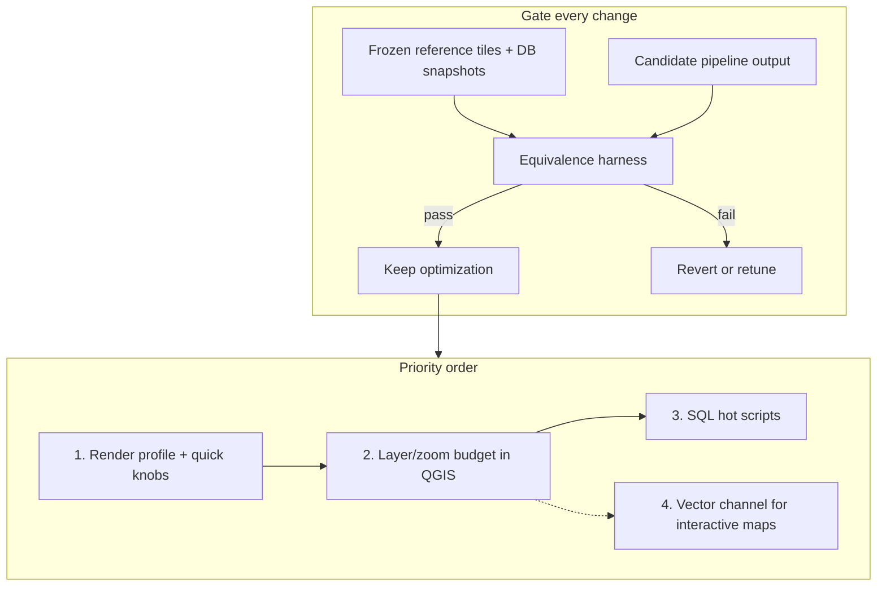

# Pipeline performance: what to optimize first

## Evidence (audit `berlin-bbox-large`, bbox `13.3958,52.4243,13.4874,52.4849`)

| Phase | Share | Signal |
| --- | ---: | --- |
| **QGIS XYZ render** | **~99%** | z18 ~7.5 s/tile; z15 ~2.2 s/tile; z16–17 ~0.8–0.9 s/tile; 222 layers; Qt “512 MB allocation limit” spam |
| SQL processing | ~1 min | `building.sql` 34 s; stop lines / lane divider / crossing / labels next |
| Import | seconds | Not the bottleneck at extract scale |
| osmium extract | cached | Out of audit; ignore for ROI |

Starter bbox already showed the same shape: render ≫ everything else.

---

## Priority 0 — Equivalence harness (do this before optimizing)

Goal: “same as reference in a meaningful way” — **not** byte-identical JPEGs.

### Reference freeze

1. Pick two fixed AOIs:
   - **Starter** (fast CI): `13.4132,52.4715,13.4312,52.4821`
   - **Large** (release gate): `13.3958,52.4243,13.4874,52.4849`
2. Freeze inputs: PBF identity (path + size + mtime or content hash), CRS, QGIS project hash, render flags (metatile, gutter, dpi, format, bg).
3. Produce **reference tiles** once into e.g. `audit/reference/<label>/tiles/{z}/{x}/{y}.jpg` (git-LFS or local-only; do not commit megabytes of tiles unless you want a tiny starter subset).
4. Optional DB snapshot notes: row counts for `building*`, `highway_area`, `road_marking_*`, `lanes*`, `label_*`.

### What “same enough” means

| Check | Method | Pass when |
| --- | --- | --- |
| **Visual (primary)** | Per-tile **SSIM** (or MS-SSIM) + **pixelmatch** with threshold; ignore pure JPEG round-trip | Mean SSIM ≥ ~0.98; % pixels differing above ΔE/RGB threshold ≤ ~1–2%; no tile below SSIM floor (~0.95) except known allowlist |
| **Worst-tile gallery** | HTML report sorted by worst SSIM | Human spot-check of top N diffs |
| **Structural (secondary)** | SQL `COUNT(*)` / bbox counts on key tables after prep | Counts identical, or within documented tolerance if SQL changed intentionally |
| **Coverage** | Same z/x/y set present | No missing/extra tiles in the compare set |

Small AA / JPEG / font-hinting diffs should **not** fail: use SSIM + capped pixel-diff %, not hash equality.

### Compare set (keep it cheap)

Do **not** diff all ~6.6k tiles every time. Use:

- Full starter bbox z15–18 (~278 tiles) for every candidate.
- Large bbox: **named spots** (intersection, dense housing, trees, parking street, park/water) × z15,z17,z18 — same idea as the MapLibre compare plan’s `locations.ts`.
- Optional: random 1% sample of large-bbox tiles as a smoke net.

### Wiring

- Script: e.g. `audit/compare-tiles.py` (or under `render/`) reading reference dir + candidate dir → `report.md` + `diffs/`.
- Hook into `PERF_AUDIT_DIR` optionally: after render, run compare and attach scores to the audit run.
- CI later: starter-only gate.

Ship the harness **before** Priority 1 so every optimization has a pass/fail.

---

## Priority 1 — Render: profile, then cheap knobs (highest ROI)

Wall-time king. Order inside this bucket:

1. **Instrument which layers cost paint**  
   Temporarily render with layer subsets / QGIS profiling; record ms per metatile at z15 vs z18. Hypothesis: effects (shadows/glows), SVG markers, labels, and dense road markings dominate z18.

2. **Quick wins (likely look-preserving)**  
   - Raise / disable Qt image IO alloc limit (`QT_IMAGEIO_MAXALLOC`) — addresses the 512 MB rejects seen in the large run.  
   - Install **Open Sans** (or map family in the project) — removes alias cost and font mismatch vs reference.  
   - **Per-zoom metatile size**: smaller metatiles at z18 if memory/effects blow up; larger at sparse zooms if overhead dominates.  
   - **Gutter**: measure 0 vs 1 (label/clip artifacts vs speed).  
   - Skip clearly empty metatiles if cheap to detect.  
   - **Parallel metatile workers** (N processes, disjoint tile ranges) once single-worker paint is understood — biggest throughput lever if CPU-bound.

3. **Accept only if equivalence harness passes.**

---

## Priority 2 — Render: cartographic cost budget

Only after knobs plateau:

- Tighten **scale-dependent visibility** so z15 does not paint z18 detail (z15 was ~2.2 s/tile — suspicious for overview).  
- Reduce **enabled effect stacks** at low zoom.  
- Fewer simultaneous **SVG / raster-fill** rules where a simple fill/line suffices.  
- Consider rendering **z15–16** with a simplified layer set and z17–18 full — if the harness agrees they still “read” as the same map.

This is higher risk for visual drift → harness is mandatory.

---

## Priority 3 — SQL prep (secondary)

Worth it for full-city / repeated refresh, not for current wall-time:

| Script | Large-bbox time | Why look |
| --- | ---: | --- |
| `building.sql` | ~34 s | Half of prep |
| road_marking stop / divider / crossing | ~6–4 s each | Geometry-heavy |
| `label_highway` / `housenumber` | ~4 s | |
| lanes connectivity / offset / dual | ~2 s each | |

Approach: EXPLAIN, indexes on join keys/geoms, avoid repeat `ST_Transform`, materialize shared intermediates once. Equivalence = **structural counts + geometry checksum samples** (e.g. `ST_AsBinary` hash on a fixed `osm_id` set), plus a short tile compare (SQL changes can shift markings).

---

## Priority 4 — Strategic: vector channel (interactive performance)

The existing MapLibre/PMTiles plan is the path to **interactive** performance (no 7 s/tile QGIS path). Keep QGIS raster as:

- visual **reference** for the equivalence harness, and  
- optional high-quality export.

Reuse the same locations + pixel/SSIM gallery for raster-vs-vector later (already sketched in the MapLibre plan). Do not block Priority 1–2 on the vector port.

---

## What not to optimize yet

- osmium extract (cached; not audit-timed)  
- osm2pgsql at extract scale  
- Micro-SQL scripts under ~0.5 s  
- Byte-identical JPEG reproducibility  

---

## Suggested sequence (concrete)

1. **Week-now:** Equivalence harness + freeze starter reference tiles.  
2. **Next:** Render profile (layer cost) + Qt alloc / font / metatile knobs; re-audit large bbox z15–17 fully, z18 sample.  
3. **Then:** Parallel metatiles if still CPU-bound and harness-green.  
4. **Then:** Layer/zoom budget changes with harness.  
5. **Parallel track:** MapLibre vector channel for product UX speed.  
6. **Later:** `building.sql` + marking SQL when prep or city-scale hurts.

Success metric: large-bbox **z15–18 wall time** down by ≥2× (stretch 5×) with starter equivalence still green and large-spot SSIM within thresholds.
