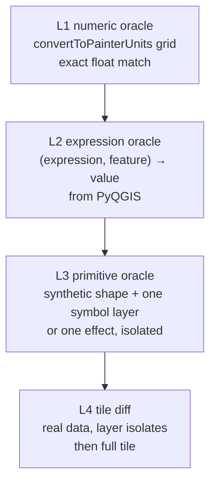

## Progress

- **2026-08-01 (full-approx shadows/trees/landuse)** — `/implementer` on `cursor-grok-4.5-high` (no commit; parent finish-work).
  - Landuse palette aligned to `vector` colors + explicit urban greys (`residential`/`commercial`/`retail`/… → `#d8dacf`/`#dbdde1`, never `#ffe9e9`). Tile `17/70422/43011` classes are greens/`ground`/`kindergarten` — large pink areas are building footprints (~38%), not landuse mispaint.
  - Building SE drop-shadow (premul tint + 3× box blur; ~2.5 m / 2.2 m / α 0.28, `#232323`). Soft trees: crown α≈0.62 + darker under-disk.
  - Vite `resolveRustTilesRoot`: newest `full-approx-*/rust` / `bench-*/rust` by mtime first, then `latest-rust`.
  - Suite `runs/full-approx-20260801-175611/`: mean **12.7% → 11.0%**, max **14.2% → 13.3%**, intersection **12.65% → 10.59%**. Still short of &lt;10% mean (labels/textures/effects). Report updated.
- **2026-08-01 (full-approx pivot)** — `/implementer` on `cursor-grok-4.5-high` (no commit; parent finish-work).
  - **Pivot from isolate-only to full-approx.** User feedback: Rust compare pane was roads-only; MapLibre vector looked closer to QGIS. Expanded `rust/srk-render` with `--layers full-approx` (default) keeping `highway_area` isolate.
  - Modules: `tile.rs`, `palette.rs`, `paint.rs`, `layers.rs`. Paint stack: landuse → pitch → water → waterway → path/service → highway_area → building* → tree. Deferred: labels, SVG, RasterFill, effects (documented).
  - Harness: `manifest-full.json` (10 tiles z15–z20), `scripts/render-suite-full.sh` → `runs/full-approx-<ts>/{qgis,rust,compare}/` + `latest-rust` symlink. Vite prefers `full-approx-*/rust` / `RUST_TILES_ROOT`. Compare label: "Raster (Rust full-approx)".
  - E2E after one fix pass (path under area, tree α): mean pixelmatch **12.7%**, max **14.2%**, 10/10 `bad`, 0 hard-fail. Intersection `17/70422/43011` shows parks + pink buildings + trees + roads. Report: `audit/tile-regression/FULL_STYLE_REPORT.md`.
  - `p3-symbols` / `p3-order`: **partially in progress** (flat SimpleFill/Line/circle crowns + draw-order sandwich; no SVG/RasterFill/effects/symbol-levels yet).
  - `p4-verdict` stays **pending**; full-approx is evidence, not go/no-go.
- **2026-08-01 (p0 + calibrate + style-ir)** — `/implementer` on `cursor-grok-4.5-high` (no commit; parent finish-work).
  - **`p0-decisions` completed.** Existing `audit/sql-compare/reference/baseline.json` freeze recorded in `fixture-lock.json` (sha256 `bf1a594c…`, mtime 2026-08-01 14:59, freeze git `e3d3df82`, large bbox). Live starter-bbox DB snapshotted as `reference/starter.json` (does not match baseline — expected). Also pinned: HEAD `562ca96`, PostGIS image `imresamu/postgis:17-3.5-bookworm` digests, osm2pgsql 2.1.1, PBF sha256. No multi-hour re-freeze.
  - **`p1-calibrate` completed.** `audit/tile-regression/CALIBRATION.md`: QGIS A/A on 3 tiles = **0%**; dpi 96 vs 97 on `highway_area` = **0%**; layer swap landuse = **26.3%**; bg wipe = **92.5%**; metatile referenced from `RENDER_MODE.md`. Confirmed bands **ok≤1% / review≤5% / bad≤50% / hard-fail >50%**. `--no-fonts` skipped (isolate has no labels).
  - **`p2-style-ir` completed** (highway_area-scoped IR + full inventory). `style/scripts/dump-style.py` + README; outputs in `style/generated/` (gitignored): inventory (**256** maplayers / **64** names; labeling **12** unique / **30** entries; opacity **22** unique / **100** entries; DDP **3604**; SvgMarker **185**), `expression-surface.json` (`@mercator_scale` ×2618), `style-ir.json` (**7** `highway_area` entries ×13 rules). Full `--ir-all` still optional.
- **2026-08-01 (starter-bbox timing bench)** — `/implementer` on `composer-2.5` (no commit; parent finish-work).
  - Extended `srk-render` CLI: `--bbox` + `--zmin`/`--zmax` (defaults 15/18), tile enumeration (Web Mercator, same math as `xyz_tiles.py`), `--quiet`, `timing.json` + one-line stderr summary. `--tiles` still supported.
  - `audit/tile-regression/scripts/bench-bbox.sh`: builds tile list, times Rust release + QGIS `highway_area` isolate (same 278 tiles) + optional full-style QGIS (metatile 8).
  - **278 tiles** starter bbox z15–18, Darwin arm64 10 CPUs: Rust **628 ms** (2.3 ms/tile) vs QGIS isolate **35.6 s** (128 ms/tile) ≈ **57×**; full QGIS today **92.2 s** PNG; historical full style **62.3 s** (context only). Report: `audit/tile-regression/TIMING.md`. Visual parity unchanged (~0.08% smoke mean) — timing is not a migration verdict.
  - `p4-verdict` stays **pending**; `TIMING.md` is input to the go/no-go report.
  - Dumped QGIS `highway_area` rules → `audit/tile-regression/HIGHWAY_AREA_RULES.md` (XML; PyQGIS project load hung). Class fills only paint an explicit `area:highway` IN-list; **`parking_space` / `traffic_island` excluded**; outline width 0.
  - Rust `srk-render`: SQL `IN` filter + drop catch-all + remove 0.5 px dark stroke. Smoke **before → after**: mean **1.96% → 0.079%**, max **8.85% → 0.203%**, bands **12 ok / 0 review / 0 bad**. Anchor **0.006%**. Gallery `runs/20260801-172219-smoke/`. Interim `REPORT.md` + `docs/rust-renderer-evaluation.md` stub.
  - `p1-harness` **completed** (honest: smoke batch + gallery + manifest done; still missing stratified sampler / budgets / SSIMULACRA2 / standard+full).
  - `p1-render-mode-decision` already **completed** (`RENDER_MODE.md`).
  - `p3-crate-skeleton` **completed** (gate spirit: 12 tiles × z15–18, multiple locations, style-filter parity).
  - `p4-verdict` stays **pending**; REPORT.md is interim evidence only.
- **2026-08-01** — `p1-render-mode-decision` done by `/implementer` on `cursor-grok-4.5-high` (no commit). Extent-based QGIS-vs-QGIS on starter bbox z15–17 (82 PNG tiles): metatile **1** vs **8** (both gutter 1, workers 1). Mean SSIM **0.9900**, min **0.8934**, mean \|Δ\|>16 **0.0029%** → `compare-tiles.py` **FAIL** on min SSIM. Dominant drift: viewport-anchored RasterFill / landuse texture phase; sparse label/edge AA secondary. Wall clock 10m02s vs 1m17s. **Canonical harness mode: `--metatile 1 --gutter 1 --workers 1 --format png`** (production metatile 8 unchanged). Docs: `audit/tile-regression/RENDER_MODE.md` + README “Canonical render mode”.
- **2026-08-01 (multi-tile smoke)** — `/implementer` on `cursor-grok-4.5-high` (user override; no commit).
  - `p1-harness` **partial / in_progress (advanced):** committed `manifest.json` smoke suite (**12** tiles, z15–z18, starter bbox only, PostGIS-filtered for `highway_area`); `scripts/lonlat-to-tile.ts`; batch `scripts/compare-run.ts` → `runs/<ts>-smoke/` with `tiles.jsonl`, `summary.json`, dark `index.html` sorted by pixelmatch; `scripts/render-suite.sh` (QGIS once + Rust once + compare). Exit **1** only if any tile pixelmatch **> 0.5** (migration mode); softer bands in summary. Still missing vs full plan: stratified `sample-tiles`, budgets/`ignores.json`, SSIMULACRA2, standard/full suites.
  - Note: most `vector/locations.ts` points fall outside the starter bbox; smoke uses `intersection` + density/neighbor/zoom picks inside the bbox.
  - Smoke E2E (`runs/20260801-170307-smoke/`): **12/12** tiles compared; mean pixelmatch **1.96%**, max **8.85%** (`18/140851/86021` density peak — QGIS style filters hide parking-like classes Rust still paints; geometry aligned, not blank/shifted). Bands: 5 ok / 6 review / 1 bad / 0 hard-fail. Exit 0. Anchor still **0.096%**.
  - `p3-crate-skeleton` gate (≥5 locs × z16–18) exercised by smoke (z15–18, multiple places); not “done” until style-filter parity improves on dense tiles.
- **2026-08-01 (MVP stop)** — Orchestrator satisfied with one-tile `highway_area` isolate visual diff (pixelmatch **0.096%**, AA rim only). Pipeline: QGIS `--tiles` + `--layers` → Rust `srk-render` → `compare-one-tile` gallery. Commits: `3cd0a98` (research + single-tile), `3196aff` (Rust slice + harness). Remaining plan phases (full harness, effects, labels, go/no-go) are follow-ups, not blockers for this MVP.
- **2026-08-01 (later)** — One-tile harness MVP + `highway_area` Rust slice by `/implementer` on Grok (user override).
  - **Anchor tile:** `17/70422/43008` (starter bbox; 3 `highway_area` features).
  - `p1-harness` **partial / in_progress:** `audit/tile-regression/scripts/compare-one-tile.ts` (Bun + pngjs + pixelmatch → `runs/<ts>/{ref,cand,diff}.png`, `metrics.json`, dark `index.html`), `scripts/render-qgis-tile.sh`, local `package.json`. Not yet: stratified `sample-tiles`, batch `compare-run`, DSSIM/SSIMULACRA2 budgets (DSSIM optional if `dssim` on PATH).
  - `p1-isolates` **partial:** `--layers` already on QGIS path; wrapper documents isolate workflow. Seam-check still pending.
  - `p3-crate-skeleton` **in_progress:** `rust/srk-render/` builds release; CLI `--tiles/--layers/--out/--format`; PostGIS via `postgres` + WKB; `tiny-skia` fill + hairline stroke; palette from `area:highway`. Gate (≥5 locs × z16–18) not yet run.
  - End-to-end isolate compare: QGIS ref vs Rust cand → pixelmatch **0.096%** (63 / 65536 px) after one stroke-width iteration. Geometry aligned (no Y-flip / CRS / blank). Remaining: AA rim, missing innerShadow blur stack, no surface textures.
- **2026-08-01** — Phase 0 (partial) + `p1-single-tile` done by `/implementer` on `cursor-grok-4.5-high` (user override; not composer).
  - Pinned `rust-toolchain.toml` to `1.96.1`; `rust/.gitkeep`; `.gitignore` for `rust/**/target/`, `audit/tile-regression/runs/**`, `style/generated/**`.
  - Stub `audit/tile-regression/` (`README.md`, `fixture-lock.json` with HEAD SHA + starter bbox; sql-compare freeze still **pending** → `p0-decisions` remains `in_progress`).
  - `render/xyz_tiles.py`: `--tiles z/x/y` (repeatable/comma-separated), optional `--layers`, forces workers=1; `render/render_tiles.sh` passes both through.
  - Verified one PNG with map content: tile `17/70422/43008` (inside starter bbox) → `/tmp/srk-one-tile-ref/17/70422/43008.png` (~72 KB, 256×256). Also verified `--layers highway_area`. Note: `17/70439/43023` from existing tiles is outside the starter DB bbox and renders blank.

## Question this plan answers

Can the **rendering step only** — PostGIS → raster XYZ tiles, everything upstream unchanged — be rebuilt in Rust closely enough that the output is accepted as the Straßenraumkarte? And if so, what tooling makes that migration provable at every step instead of at the end?

The answer this plan is built around: **the renderer is plausible, the labels are not (yet), and the tooling has to come first.** Phases 0–2 build the proof machinery and cost far less than the renderer; if the verdict is negative, the machinery is still useful (it also validates QGIS-vs-QGIS changes and the MapLibre vector channel).

## What exists today (evidence)

Rendering step, as measured in the repo:

| Aspect | Fact | Source |
| --- | --- | --- |
| Entry point | `render/render_tiles.sh` → `render/xyz_tiles.py` | — |
| Paint job | `QgsMapRendererCustomPainterJob` on an `ARGB32_Premultiplied` `QImage`, **not** a parallel job | `render/xyz_tiles.py` L489–492 |
| Parallelism | `ProcessPoolExecutor`, one QGIS per worker process ("PyQGIS is not thread-safe") | L773–838 |
| Tiles | 256 px, EPSG:3857, `ORIGIN_SHIFT = 20037508.342789244`, z15–z20 | L42–43, L323–330 |
| Metatile | core 8×8, gutter 1 tile rendered then discarded | L340–360, L494–505 |
| Settings | DPI 96, background `#ededed`, JPEG q90 default, Antialiasing on, `DrawLabeling` on, **`UseAdvancedEffects` off**, `LosslessImageRendering` on, `RenderMapTile` on | L566–575, L900–907 |
| Ground metres | `@mercator_scale` = `1/cos φ` from render extent mid-latitude, set via `setProjectVariable` | L216–221, L281–292, L562 |
| CLI | `--extent` **or** `--tiles z/x/y[,…]`; optional `--layers`; `--zmin/--zmax/--metatile/--gutter` | `build_arg_parser` + Progress 2026-08-01 |

Style, re-counted from `style/strassenraumkarte.qgz` (zip → ~20.8 MB `.qgs` XML):

| Metric | Count |
| --- | ---: |
| `maplayer` entries / unique layer names | 256 / **64** |
| Renderers | RuleRenderer 17, singleSymbol 22, categorized 18, nullSymbol 7 |
| Rule elements / categories | **812** / 492 |
| SimpleLine / SimpleFill / SimpleMarker | 1058 / 835 / 803 |
| SvgMarker / RasterFill / RasterMarker | 185 / 133 / 25 |
| MarkerLine / LinePatternFill / CentroidFill / HashLine | 59 / 44 / 42 / 42 |
| ShapeburstFill / GradientFill / FontMarker | 4 / 3 / 14 |
| GeometryGenerator / ArrowSymbolLayer | **0** / 0 |
| Enabled dropShadow / innerShadow / outerGlow / innerGlow | **77** / **60** / 7 / 1 |
| Layers with labeling enabled | **12** |
| Active data-defined properties | **≈3.7k** (`@mercator_scale` in ≈2.7k expressions) |
| Blend modes / non-default opacity | 6× Multiply, 2× Screen / 22–24 layers |

Two independent XML parses agreed exactly on every symbol-layer, rule, effect and labeling count above, but disagreed on the last two rows (3709 vs 3781 active data-defined properties, 22 vs 24 non-default-opacity layers) because "active" and "layer-level" can be filtered differently in raw XML. Those rows stay approximate on purpose: `p2-style-ir` makes them authoritative by asking PyQGIS instead of the XML, which is one of the reasons that todo exists.

Existing tooling worth building on, not replacing:

- `audit/tile-compare/` — SSIM + pixel-fraction comparison of two XYZ tile trees (`compare-tiles.py`, pass at mean SSIM ≥ 0.98). Built for QGIS-vs-QGIS; the closest thing to what we need.
- `audit/sql-compare/` — PostGIS digest freeze/compare, the way to prove data did not drift.
- `vector/scripts/screenshots.ts` — Playwright + pixelmatch + HTML gallery. Wrong domain (browser viewport, not XYZ tiles) but the right report UX.
- `render/fonts/` — Open Sans registered for headless rendering; DejaVu comes from the system.

Not present: **cargo / rustc / wasm-pack**. Also not present: any committed script that produces the style counts above (they are hand-maintained in `docs/maplibre-style-groups.md`).

## Research this plan is built on

Written for this plan, in `research/`:

| Folder | What it establishes |
| --- | --- |
| [research/qgis-rendering-internals](../../research/qgis-rendering-internals/summary.md) | Spec-level notes from QGIS `master`: `convertToPainterUnits` per render unit, per-symbol-layer paint semantics, the effect pipeline (stack blur, distance transform, offset convention), symbol levels, PAL, and `QgsRenderChecker` as a diff-harness template |
| [research/rust-raster-map-rendering](../../research/rust-raster-map-rendering/summary.md) | Crate landscape and a recommended stack: `tiny-skia` 0.12 + `resvg` 0.47 + custom CPU blur + `cosmic-text` + `tokio-postgres`/`geozero`; Vello/raqote/maplibre-rs/galileo ruled out with reasons; WASM judged a poor first target |
| [research/tile-visual-regression](../../research/tile-visual-regression/summary.md) | Metric choice and thresholds, prior art (QGIS mask images, MapLibre `allowed`/`ignores.json`, Mapnik, resvg, Skia Gold), stratified tile sampling, the crop-vs-tile seam trick, and a concrete `audit/tile-regression/` design |

## Verification strategy — the actual point of this plan

Whole-tile pixel diffs are the **last** check, not the first. Four levels, cheapest and most diagnostic first:

**L1 / L2 use PyQGIS as a programmable oracle.** QGIS can be asked what a unit conversion or an expression evaluates to, and the answers dumped as JSON. Reproducing those numbers exactly is a precondition for any pixel to be in the right place, it is testable in milliseconds, and a failure points at one function instead of at "the tile looks wrong". Most of the ~3.7k data-defined properties are covered by L1+L2 alone.

**L3 isolates one thing at a time.** A synthetic geometry rendered through a single symbol layer or a single paint effect, in both engines. This is where the stack-blur port, the dash-pattern normalisation and the marker size semantics get pinned down, away from the noise of real data.

**L4 is the harness the user asked for**: pick a tile, render it with both engines, compare, decide. Three metrics per 256×256 **PNG** tile (never production JPEG): pixelmatch ratio, DSSIM, SSIMULACRA2 — with verdicts `pass` / `needs-review` / `fail` / `ignored`, committed per-tile budgets, and CI failing on *regression against an approved budget* rather than on absolute score (during migration almost everything is red, so absolute gating is useless).

Two things make L4 trustworthy rather than decorative:

1. **Layer isolates.** Render one QGIS layer (or one OSM-`layer` bucket) with both engines. A diff then attributes to a style rule instead of to "the map". Migration progress is tracked as per-layer pass rates in `summary-by-layer.json`, which is also how work gets prioritised.
2. **Harness calibration** (`p1-calibrate`). Before the harness judges Rust, it is run QGIS-against-QGIS with one deliberate change at a time — `--workers 2`, `--metatile 8`, `--no-fonts`, DPI 97, a hidden layer — and the measured metric ranges are written down. Thresholds come from that table. This is the step that prevents months of chasing a "regression" that is really metatile geometry.

**Sampling** (`p1-harness`) is stratified via PostGIS `ST_TileEnvelope`, not hand-picked: density, one tile per styled layer (coverage-tracked, so a style rule with zero covering tiles is a harness failure), hard geometry (`layer != 0`, bridges, high `ST_NPoints`), class boundaries, label-dense tiles, tiles with features crossing the tile edge, and at least N tiles per zoom z15–z20. Three suites: smoke ~30 tiles per PR, standard ~300 nightly, full ~3000 pre-release. `vector/locations.ts` seeds the hand-picked anchors.

**Seams** are checked independently of the gutter with the crop-vs-tile trick: render a 5×5 tile block as one image, render the 25 tiles, compare each tile to its crop. Interior-edge mismatch beyond the AA rim means a boundary bug. This matters because RasterFill patterns are viewport-anchored by default and shapeburst fills explicitly declare `canCauseArtifactsBetweenAdjacentTiles()`.

**Data must be frozen first** (`p0-decisions`): a pinned PBF + osm2pgsql + SQL git SHA, verified with `audit/sql-compare/`, checksums in `fixture-lock.json`. Otherwise a renderer diff and a data diff are indistinguishable.

## Recommended Rust stack

| Concern | Choice | Why |
| --- | --- | --- |
| Rasterizer | `tiny-skia` 0.12 (BSD-3, Linebender, active) | Skia CPU subset, matching AA/stroking/dashes/gradients/patterns, `no_std` + SIMD, WASM-capable |
| SVG symbols | `resvg` / `usvg` 0.47 | 185 SvgMarker layers; deterministic cross-platform output; parse/render split allows caching `usvg::Tree` per symbol |
| Effects | Hand-ported `QgsImageOperation` passes on `Pixmap` | tiny-skia has **no image-filter graph**; QGIS's own algorithms are the spec and are simple enough to port |
| Geometry I/O | `tokio-postgres` + `geozero`/`postgis` WKB → paths | Reads the existing schema directly; no MVT round-trip (MVT would discard the rule-based styling model) |
| Text | `cosmic-text` 0.19 + pinned `render/fonts/` | Deterministic; Qt-identical glyphs are not achievable, so aim for visual parity |
| Parallelism | `rayon` per metatile | Replaces `ProcessPoolExecutor`; Rust has no PyQGIS thread-safety constraint |
| Encoding | `png` / tiny-skia `encode_png`, `zune-jpeg` for production | PNG for all comparison runs |
| Escape hatch | `skia-safe` 0.99 | If effect or text parity proves impossible on tiny-skia, real Skia has the filter APIs — at the cost of a C++ build |

Explicitly rejected for now: `vello`/`vello_hybrid` (alpha, blur unimplemented), `raqote` (weaker AA per maintainer benchmarks), `galileo`/`maplibre-rs` (client GL engines, no labels), Martin's experimental MapLibre-style raster mode (wrong style model — that is the separate [MapLibre vector channel](maplibre_vector_output_channel_301665ec.plan.md) track).

## The style contract

The Rust renderer should **consume a machine-readable IR dumped from the .qgz** (`p2-style-ir`), not a hand-translated style. Hand translation of 812 rules and ~3.7k data-defined properties would be a second source of error indistinguishable from renderer bugs, and it would rot the moment `strassenraumkarte.qgz` changes.

Only PyQGIS on the loaded project gives full fidelity: `QgsProject.read()` + `rootRule().dump()` for structure + `symbolLayer(i).properties()` + effect-stack `properties()` + the active `QgsProperty` expression strings. SLD export loses effects and most layer types; MapLibre exporters lose more; raw XML parsing misses QGIS defaults and path resolution. The dump is a generated, committed artefact so a style change produces a reviewable diff — and it retires the hand-maintained inventory counts in `docs/maplibre-style-groups.md`.

## Known hard parts, ranked

1. **Labels.** No Rust equivalent of QGIS PAL exists. PAL solves one global placement problem per render extent, which is exactly why this repo renders metatiles with a gutter. Symbology parity must therefore be measured on label-free renders, and label placement treated as a separate decision with a hybrid option (Rust symbology, QGIS or exported label anchors).
2. **Effects.** 137 enabled shadows plus glows, on MapUnit blur radii, are the dominant look of buildings, trees, landuse and the z14–z20 highway blur stack. The algorithms are portable, but per-tile CPU cost at z20 is unmeasured and may need caching or the `skia-safe` fallback.
3. **Qt vs Skia rasterization.** tiny-skia matches Skia, and QGIS paints with Qt. Expect systematic differences in AA gamma, half-pixel alignment, dash phase and miter handling. This is why thresholds are calibrated (`p1-calibrate`) rather than assumed, and why bit-exactness is explicitly not the goal.
4. **Non-obvious QGIS semantics** that naive implementations get wrong: dash values are normalised by pen width; `alignDashPattern` rewrites dashes per corner; `QPainterPath` fills use `Qt::OddEvenFill`; SimpleMarker `size` is a bounding-box diameter, not a radius; symbol levels reorder painting across *all* features; `scalemindenom` means maximum scale.
5. **`rand`/`randf` in the style.** Some symbols (tree crowns) are non-deterministic in QGIS itself. These tiles need `ignores.json` entries or a seeded agreement between engines; either way it must be a conscious decision, recorded.
6. **Gradient and Shapeburst fills** (7 uses). Shapeburst needs the Felzenszwalb distance transform per feature on a padded local image; low count, high effort, so schedule last.

## Orchestration

Attach `@orchestrator-worker` and dispatch each todo with `/implementer <scoped brief>`. **This iteration (Phase 0 + `p1-single-tile`) uses `cursor-grok-4.5-high` for implementer/verifier by explicit user override** (not the default `.cursor/agents/` pin `composer-2.5[fast=false]`). For later todos, omit the Task inline `model` unless the user overrides again so the agent pin applies. Validation passes go to `/verifier` (readonly).

Sequencing: `p0` first. Then `p1-single-tile` → `p1-render-mode-decision` → `p1-harness` → `p1-calibrate` are strictly sequential (each depends on the previous being trustworthy); `p1-isolates` can run beside `p1-harness`. `p2-style-ir` is independent of all of phase 1 and can run in parallel. `p2-oracle-units` and `p2-oracle-expressions` depend on `p2-style-ir` but are independent of each other. Phase 3 requires phases 1 and 2 complete, and its work packages are sequential against a stable crate — with the exception of `p3-effects`, whose L3 primitive oracle can be developed in parallel with `p3-crate-skeleton`.

## Iteration loop (phase 3)

Per work package: `cargo test` (oracle rows) → render the package's isolate tiles with both engines → `bun run audit/tile-regression/scripts/compare-run.ts --suite smoke` → read `index.html` sorted by DSSIM → fix or record a budget → repeat. A package is done when its isolate tiles pass and `summary-by-layer.json` shows no regression elsewhere.

## Out of scope

Everything upstream of rendering: `run.sh`, osm2pgsql, the ~41 SQL scripts, the Lua flex config. The renderer reads PostGIS read-only. Also out of scope: replacing the QGIS raster channel in production before the phase 4 verdict, the MapLibre vector channel (separate plan), and WASM beyond the optional `p5-wasm` spike.
