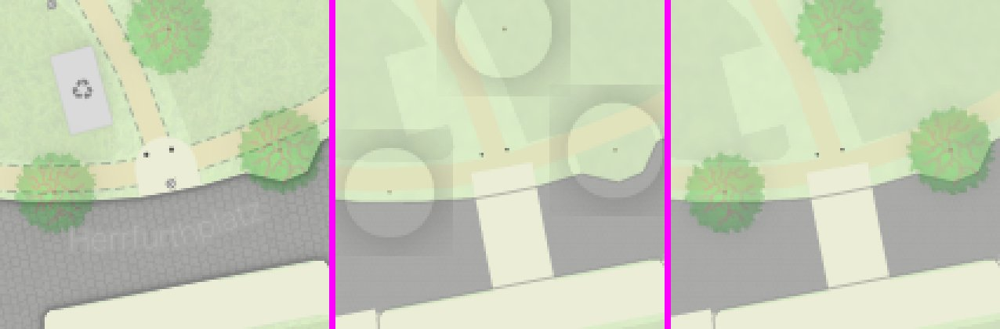

# Trees parity (full-approx vs QGIS)

Scope: `tree crown` (RasterMarker), `trunk`, and the shrub category of the crown layer in `rust/srk-render` (`paint_tree`, `draw_tree_crown_marker`, `DropShadow::tree/shrub`, `tree_markers.rs`). Landuse, streets, buildings and labels are untouched.

## What changed

The old crown path drew a pale disc, not the leaf image. Two defects caused it:

1. **The PNG was never visible.** The transform in `draw_tree_crown_marker` applied the `-width/2` translation after the scale, so the marker landed outside the buffer. Only the shadow knockout remained, which read as a light disc with a grey crescent.
2. **Shadow was a disc with a box-clipped blur.** The shadow used a circle, not the crown silhouette, and was blurred inside a buffer too small for the blur radius, giving the grey squares.

Now, per QGIS symbology (`style/strassenraumkarte.qgz`, layers `tree crown`, `trunk`):

- **Crown** — RasterMarker `broadleaved.png` / `needleleaved.png`, diameter = `@mercator_scale * diameter_crown` (fallback 7 m trees / 4.5 m shrubs, as before), rotation from `rotation`. Drawn with the layer opacity **0.25** (was 0.38 "to match visual weight"; QGIS value now used).
- **Marker sampling** — `TreeMarkerCatalog` builds a 2×2 box mip chain once per PNG. Each crown samples the smallest mip that is at least its size, so the downscale stays under 2× and the leaf texture survives at z17 (was a single 678 px bilinear stamp at 30× downscale, which aliased to flat colour).
- **Drop shadow** — silhouette of the crown alpha, blurred (radius = blur/2 px, 3 box passes), offset by the QGIS `offset_angle`/`offset_distance`, tinted #232323 at opacity 0.4 (tree) / 0.4 with blur 1.5 m (shrub), multiplied onto the background. The sharp crown mask is knocked out of the shadow: QGIS shows no shadow inside the crown (interior colour matches the unshadowed composite), so this is an empirical fit.
- **Trunks** — collected and drawn after all crowns, because the QGIS layer tree lists `trunk` above `tree crown`. Colour #8d8a63, layer opacity **0.75** (was 0.8), diameter = `@mercator_scale * circumference / π` (unchanged).
- Removed `fill_tree_crown_soft` (unused), the procedural soft-disc crown path and the `+12` brightening/pre-blur of the PNG.

## Metrics (pixelmatch, `compare-run.ts`, `manifest-full.json`, full-approx)

| Tile | Label | Shared baseline (quoted) | Before (HEAD re-render) | After | Trees in tile |
| --- | --- | ---: | ---: | ---: | --- |
| 15/17606/10752 | density z15 | 25.60% | 26.22% | 26.22% | no (layer starts z17) |
| 15/17605/10752 | intersection parent z15 | 23.15% | 24.67% | 24.67% | no (layer starts z17) |
| 16/35212/21505 | density z16 | 20.19% | 21.19% | 21.19% | no (layer starts z17) |
| 16/35211/21505 | intersection z16 | 19.25% | 19.89% | 19.89% | no (layer starts z17) |
| 17/70422/43011 | intersection z17 (Herrfurthplatz) | 15.79% | 16.95% | 11.02% | yes |
| 19/281691/172046 | intersection z19 | 15.96% | 16.87% | 6.61% | yes |
| 18/140845/86023 | intersection z18 | 14.90% | 16.10% | 6.44% | yes |
| 17/70425/43010 | density peak z17 | 14.71% | 15.84% | 12.58% | yes |
| 18/140851/86021 | density z18 | 10.85% | 11.73% | 7.07% | yes |
| 20/563382/344092 | intersection z20 | 9.23% | 10.30% | 2.28% | yes |
| **mean** | | **16.96%** | **17.97%** | **13.80%** | |

- The "Shared baseline" column is `/tmp/parity/baseline/compare` (16.96%). Re-rendering the current branch head (`d0e66ad`, which includes the ink commits merged into the parity branch) gives 17.97% before any tree change, so "Before" is the like-for-like reference. The ~1 pt gap is not from the tree code; it was not investigated further.
- Tiles without trees (z15/z16) are byte-identical in pixelmatch before and after, so no regressions there.
- Tile-level mean drops by 4.2 pts; on tree tiles the drop is 5–10 pts at z17–20.

## Before / after crop

`trees.jpg` (z19 `19/281691/172046`, px 60–200 at 3×): left QGIS reference, middle before, right after.

## Performance

Dense woodland at z18 (`18/140839/86014`, ~97 trees) renders in ~117 ms per tile at `--workers 1`, `--metatile 1`. The full 10-tile manifest renders in ~2.4 s wall (before: ~3.6 s, cold DB).

## Remaining gaps

- Trees without `diameter_crown` use a fixed 7 m (QGIS `randf(5,9)` per feature), so their size is only approximate.
- The shadow is an empirical fit: QGIS shows only a faint SE-edge darkening, which the knockout approximates. A full QGIS effect-stack emulation (layer-level opacity compositing) was not attempted.
- Crowns at z17–18 are slightly darker in Rust than in QGIS. Layer opacity 0.20 scores better on the z17–18 tiles (mean 13.72% vs 13.93% in a test run) but was not adopted: 0.25 is the QGIS value and the gap is probably from the downscale filter, not the opacity.
- Trunk shadow (QGIS blur 2.5 m, opacity 0.07) is omitted; it is below the visible threshold at these scales.
- Remaining pixelmatch on tree tiles is dominated by labels, landuse/ground greys and buildings (outside this change). Trees now contribute little of the residual.
- The `rotation` column was not verified against a real row; the rotation path is implemented but only exercised when non-null.
