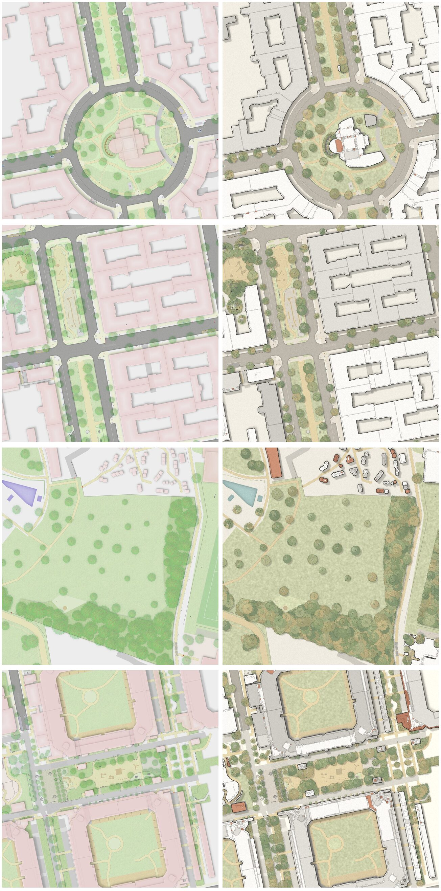

# Exploration 01 — Landscape-architecture plan

_Left: today's rendering. Right: a mockup of the target, made by [`tools/restyle_mockup.py`](../tools/restyle_mockup.py) from the left image. It is a target picture, not an implementation; see [How the mockups were made](#how-the-mockups-were-made)._

## Mission statement

> **The Straßenraumkarte should read like a site plan that a landscape architect drew for the street, not like a map.**
>
> The open space is the subject: lawns, planting, trees, paving and play areas are drawn with care and in soft, earthy, slightly pastel colours, and every tree is a small drawing of its own. Buildings recede into a calm, crisp contrast: white or light grey volumes with sharp dark outlines and a cast shadow, with an occasional red roof as an accent. The result must be produced **directly by the data pipeline** (SQL + QGIS) from OSM data, at every zoom level, without manual post-processing.

What this means in one sentence per element:

- **Ground**: the plan is about surfaces. Each surface (lawn, meadow, sand, paving, asphalt) has its own muted tone and a light grain, so it looks drawn and not filled.
- **Trees**: drawn symbols with a scalloped crown, a lit side, a shadow side, a trunk dot and a cast shadow. Single trees stay readable; woodland is a mass of overlapping crowns, not a green blob.
- **Buildings**: the "paper white" of the plan. Crisp outline, flat light fill, parts separated by thin lines, a hard shadow towards SE. Only a small share has a terracotta roof.
- **Streets**: warm grey, quieter than today, so the green and the people's space carry the picture. Cars, markings and furniture stay, but in greys.
- **Colour budget**: no saturated colour anywhere except small accents (red roofs, play equipment, water).

## Style attributes

Full evidence, measured colours and 25 references: [research-notes.md](research-notes.md).

### Palette (first proposal)

Used in the mockups; starting point for the QGIS style. Derived from the measured historic plans in the research notes, shifted lighter so the street-space detail stays legible.

| Element | Today (approx.) | Target | Notes |
|---|---|---|---|
| Paper / unbuilt yards | `#ececec` | `#ebe7dc` | warm, not grey |
| Lawn | `#cedeb9` | `#cdd2ad` | sage-pastel, light grain |
| Meadow / rough grass | — | `#bcc29b` | darker, broken, dabs |
| Tree crowns (mix per tree) | `#93bc7b` translucent | `#9caa80`, `#8d9e74`, `#b1b58b`, `#a8a479`, `#7f9270`, occasionally `#c3b386` | vary per tree ID, 85 % opacity |
| Crown outline / branches | none | crown colour × 0.6 | thin scalloped line, 5–7 radial strokes |
| Sand, paths, playground | `#e3e1bb` | `#e0cfa7` | ochre |
| Sidewalk / paving | `#e9e3dd` | `#e2dbcd` | optional joint pattern at z19+ |
| Carriageway | `#a0a09d` | `#bdb7ab` | warm grey, lighter than today |
| Water | `#b4b4f0`-ish | `#a7c2bf` | muted teal, darker edge |
| Building fill | `#e9d8d8` pink | 55 % `#fbfaf6`, 20 % `#e2dfd8`, 12 % `#cfccc5` | white / light grey mix |
| Roof accent | — | `#cf9377`, `#bb7f66` | ~10 % of building parts, never a whole block |
| Building outline | soft shade | `#2e2d2b` | crisp, heaviest line in the plan |
| Shadows | blurred grey | multiply 20 % (buildings), 35 % (trees), towards SE | fixed sun azimuth |

### Line hierarchy

Building outline (heaviest) → tree crown outline → kerbs, walls, fences → road markings → paving joints (lightest, only at z19+). Lines are dark warm grey, never pure black.

### Tree vocabulary

1. **Deciduous solitaire**: scalloped circle (8–13 bumps, ±7 % radius), lighter cap offset to NW, darker rim, 5–7 radial branch strokes, trunk dot, offset shadow.
2. **Woodland / tree group**: many overlapping crowns at 85 % opacity, varied hues, one shared shadow.
3. **Street tree row**: same symbol, slightly smaller and more uniform in colour.
4. **Conifer** (if tagged `leaf_type=needleleaved`): star/spiky outline, darker.
5. **Shrub / hedge**: irregular blob band with darker outer edge, no branch strokes.

### Buildings

Light fill, crisp outline, building parts separated by thin lines (we already have `building_parts_dissolved_height`), hard cast shadow (we already have `building_shade`). `roof:colour` from OSM where tagged; otherwise a deterministic pseudo-random pick by building ID, with red only on small parts.

## Mapping to the current pipeline

| Target element | Existing source (QGIS layer / SQL) | Change needed |
|---|---|---|
| Tree symbols | `tree crown`, `trunk`; `data/processing/sql/tree.sql` | Replace the translucent disc with a geometry-generator or SVG-based crown: scalloped polygon from crown radius (SQL: `ST_Buffer` + sine-perturbed ring, seeded by `osm_id`), highlight and shadow as offset copies. Colour picked by `osm_id % n` or by `genus`/`leaf_type`. |
| Woodland masses | `landuse` (forest/wood), `scrub (width shade)` | Fill polygon with seeded point grid (`ST_GeneratePoints` with seed), each point rendered as a crown symbol. |
| Building fill + outline | `building_parts_dissolved_height`, `building_lines` | New palette; outline width up; per-part colour from `roof:colour` or hash. |
| Building shadow | `building_shade` | Keep geometry, change to multiply with fixed SE offset, harder edge. |
| Lawn grain | `landuse surface` | Raster fill / texture at low opacity, or QGIS noise via shapeburst + random marker fill. |
| Roads, sidewalks | `highway_area`, `path (way, fill)` | Palette only. |
| Cars, markings, furniture | `parking cars`, `road_marking_*`, `feature_*` | Desaturate to warm greys (except play equipment). |

## Open questions

- How do tree symbols degrade at z16–17 (crown < 4 px)? Probably plain soft discs below z18.
- Pastel vs. modern saturated olive: the research shows modern Photoshop plans are often more saturated. We start pastel (historic plans) and test both.
- Do we want paper grain in the tiles? It tiles visibly unless it is world-anchored.
- Which sun azimuth and shadow length? Proposal: azimuth 315° (light from NW), one value for the whole map.
- Labels: today's sans-serif street names fit; an optional spaced-capitals style for park names.

## AI target-picture prompts

No image-generation model was available in the session that set this up, so the mockups are procedural. To compare with an AI restyling, feed a scene from [`../scenes/`](../scenes/) to an image model with this prompt:

> Redraw this map tile as a hand-rendered landscape architecture site plan, top-down orthographic view, exactly the same geometry. Earthy pastel palette: sage lawn, ochre sand paths, warm grey asphalt, cream paper background with subtle grain. Every tree as an illustrated plan symbol: scalloped crown outline, lighter top-left, darker rim, fine radial branch lines, small trunk dot, soft cast shadow to the bottom-right; woodland as overlapping translucent crowns in varied olive and sage tones. Buildings as crisp white and light grey volumes with sharp dark outlines and a hard shadow to the bottom-right; a few small buildings with terracotta red roofs. No perspective, no 3D, no text changes, no new objects.

Save results into `mockups/ai/` with the model name in the file name and commit only the ones worth keeping.

## How the mockups were made

1. [`tools/make_scenes.py`](../tools/make_scenes.py) stitches four 4×4 z19 tile blocks (see [`../scenes/`](../scenes/)).
2. [`tools/classify.py`](../tools/classify.py) classifies pixels by colour into ground classes (building, road, sidewalk, sand/path, lawn, tree, water, other).
3. [`tools/restyle_mockup.py la`](../tools/restyle_mockup.py) recolours the ground classes (keeping the source luminance as detail), splits building blocks into parts using shade edges, places tree crowns by disc packing inside the tree mask, and draws everything in the target style.

Known mockup artefacts that are **not** part of the target: ragged building edges where the source had inner shadows (scene D), building parts that are split wrongly, playground equipment rendered grey.

## References

- [research-notes.md](research-notes.md): attributes, measured palette, 25 references, production techniques, procedural precedents.
- `references/web/`: downloaded reference images (local only, not committed; see [references/README.md](references/README.md)).
- `references/user/`: place for Tobias's collected screenshots (local only).
