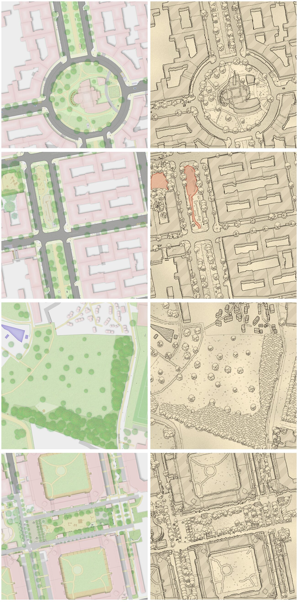

# Exploration 02 — Fantasy-book ink map

_Left: today's rendering. Right: a mockup of the target, made by [`tools/restyle_mockup.py ink`](../tools/restyle_mockup.py) from the left image. It is a target picture, not an implementation; see [How the mockups were made](#how-the-mockups-were-made). Scene B shows the accent colour on the two playgrounds._

## Mission statement

> **The Straßenraumkarte should look like the map on the endpaper of a fantasy novel: a hand-drawn black ink drawing on warm paper, in which Neukölln's streets, courtyards and parks become a place you want to explore.**
>
> The ground stays a plan (streets, squares, lawns, water are drawn from above), but everything that stands up is drawn standing up: houses show their roofs and south facades, landmarks rise above them, trees are little upright crowns that overlap like in a forest. The drawing is monochrome so that **one category at a time can be lifted out in a single accent colour** — e.g. all playgrounds in red ink — while the rest of the map stays black and white. The result must be **rendered automatically by the pipeline** (SQL + QGIS) from OSM data, without hand work.

The two guiding questions:

1. **What is plan, what is pseudo-3D?** (see the rules below)
2. **How does the accent work?** One colour, one category, as line and glyph, never as a large flat fill.

## Plan vs. pseudo-3D

Rules distilled from Merian, Braun & Hogenberg, Schedel and fantasy city maps (evidence in [research-notes.md § A](research-notes.md#a-pseudo-3d-vs-plan-view)):

| Element | View | Treatment |
|---|---|---|
| Streets, squares, sidewalks, lawns, sand, water | **Plan** | Outlines; stipple for sand/roads, grass tufts on lawns, wave strokes on water |
| Ordinary buildings | **Oblique, low** | Footprint extruded towards north by a fixed short height (≈ 12–18 px at z19, not true scale); roof face hatched, south facade with window ticks |
| Landmarks (church, town hall, school, tower, `building=church`, `amenity=place_of_worship`, `historic=*`) | **Oblique, tall** | 2–3× the height of ordinary buildings plus an icon (tower, spire, dome) |
| Trees, woodland | **Upright** | Side-view crown (scalloped outline, trunk, shading strokes on the lower right, ground tick); woodland = densely overlapping crowns |
| Play equipment, benches, fountains, lamps | **Upright icons** | Small elevation glyphs anchored at the node |
| Cars | **Omitted** (or tiny plan outlines at z20) | They break the fiction and clutter the drawing |

Fixed rules that make it work programmatically:

- **One view direction for the whole map**: camera from the south; objects are shifted/extruded towards north (up). This keeps tiles seamless.
- **Painter's order south-to-north**: draw objects sorted by the y of their footprint bottom (northern first), so southern objects overlap northern ones. In QGIS: symbol-level ordering by `y_min` descending, or a precomputed `draw_order` column in SQL.
- **Occlusion by paper fill**: every upright object first paints paper colour, then ink. Nothing is transparent.
- **Zoom gates**: z15–16 plan only (buildings as hatched blocks, trees as dots); oblique buildings from z17; facades, window ticks and tree shading from z18/19.

## Ink vocabulary

| Element | Ink treatment |
|---|---|
| Paper | `#efe2c3` warm parchment, faint low-frequency blotches, light vignette only in print layouts (not in tiles) |
| Ink | `#2a241d` sepia-black, 92 % opacity, multiply |
| Building outline | medium line; roof hatch 45°, 5 px spacing, 40 % ink |
| Facade | window ticks 9 × 8 px grid, 60 % ink |
| Road edge / kerb | thin solid line; carriageway with sparse stipple |
| Paths, sand | denser stipple, dashed edge |
| Lawn | grass tufts (3 strokes), ≈ 1 per 900 px² |
| Water | horizontal wavy hatching + heavy bank line |
| Trees | scalloped crown, trunk, 1–2 dozen shading strokes, ground tick |
| Hand feel | low-frequency displacement (≈ 1 px) on all ink lines; in QGIS: random offset expressions per vertex (see Woodruff 2024) |
| Accent | `#c8452c` vermilion: outline + 45° hatch + glyphs of the highlighted category, light wash below; nothing else in colour |

## Accent colour (category highlight)

- **One category per map**, chosen at render time (parameter, e.g. `--accent playground`). Candidates: playgrounds, benches, drinking water, bicycle parking, trees of one genus.
- The accented features are drawn in the accent ink (line, hatch, glyph) above the black ink, with a thin paper halo where they cross ink.
- Pair colour with shape (the glyph) so it does not rely on colour alone.
- Implementation idea: every ink layer has its colour from a project variable `@ink`; accented layers use `if("category" = @accent_category, @accent, @ink)`. One QGIS project, many highlighted variants.

## Mapping to the current pipeline

| Target element | Existing source | Change needed |
|---|---|---|
| Oblique buildings | `building_parts_dissolved_height`, `roof shape` | SQL: roof polygon = footprint translated north by `h`; facade polygon = (union of footprint sweeps) minus roof. `h` from a stylised function of `building:levels` (clamped), landmarks × 2.5. Draw order column. |
| Landmark icons | building tags (`building=church`, `amenity=place_of_worship`, …) | Point at roof centroid + SVG tower/spire symbol anchored at the base. |
| Upright trees | `tree crown`, `trunk` (`tree.sql`) | Point symbol with anchor at the bottom (trunk base), crown SVG/geometry generator; `draw_order = -y`. |
| Woodland | `landuse` forest/wood | Seeded point fill, same tree symbol, sorted by y. |
| Ground (plan) | `highway_area`, `path`, `landuse surface`, `water body` | Ink line + pattern fills (stipple, tufts, waves). |
| Accent | `playground_polygon`, `playground_node`, `sandpit` | Colour via `@accent_category` switch. |
| Cars | `parking cars` | Hidden. |

## Open questions

- Extrusion height: stylised constant or derived from `building:levels`? Constant reads better as "drawn"; levels give more character. Probably levels mapped to a narrow range.
- Do oblique buildings across tile/metatile edges stay seamless? The extrusion is a pure translation, so yes, as long as the gutter is larger than `h`.
- How much does the occlusion hide? Streets north of a block lose ≈ `h` px of their southern sidewalk. Acceptable in the fiction; check at z18.
- Labels: serif capitals for districts and squares, italic for parks and water, curved along streets.
- Pure black vs sepia: start sepia-black on parchment for tiles; offer pure black on white for print.

## AI target-picture prompts

No image-generation model was available in the session that set this up, so the mockups are procedural. To compare with an AI restyling, feed a scene from [`../scenes/`](../scenes/) to an image model with this prompt:

> Redraw this city map tile as a hand-drawn black ink and pencil map from a fantasy novel (in the spirit of Tolkien endpaper maps and Merian bird's-eye city views), on warm parchment paper. Keep the exact street layout. Streets, squares, lawns and water in plan view: thin ink outlines, stippled roads, small grass tufts on lawns, wavy lines on water. Buildings drawn slightly oblique as seen from the south: hatched roofs shifted upwards, short south facades with small window marks. The church in the centre drawn taller, with a tower and spire. Trees drawn as small upright scalloped crowns with trunks, overlapping like a forest where dense. Monochrome sepia-black ink only, except playgrounds which are outlined and hatched in vermilion red. No cars, no modern symbols, no colour fills.

Save results into `mockups/ai/` with the model name in the file name and commit only the ones worth keeping.

## How the mockups were made

1. [`tools/make_scenes.py`](../tools/make_scenes.py) stitches four 4×4 z19 tile blocks (see [`../scenes/`](../scenes/)).
2. [`tools/classify.py`](../tools/classify.py) classifies pixels by colour into ground classes.
3. [`tools/restyle_mockup.py ink`](../tools/restyle_mockup.py) draws parchment, plan-view ground textures, extrudes each building block north (sorted south-most last), places upright tree crowns by disc packing inside the tree mask (sorted by y), marks compact sand areas as playgrounds and draws them in the accent colour, and finally applies a slight hand wobble to all ink. In scene A the central building is treated as a landmark (`--landmark`) and gets a tower.

Known mockup artefacts that are **not** part of the target: building blocks are extruded as a whole (no per-building height), ragged edges where the source had inner shadows, the playground in scene D is not detected (trees cover it), the landmark tower is a placeholder icon.

## References

- [research-notes.md](research-notes.md): plan vs. 3D rules, accent colour examples, line vocabulary, procedural precedents (Watabou, rough.js, Winkenbach & Salesin, Woodruff's QGIS hand-drawn styles).
- `references/web/`: downloaded reference images, mostly public-domain bird's-eye views (local only, not committed; see [references/README.md](references/README.md)).
- `references/user/`: place for Tobias's collected screenshots (local only).
