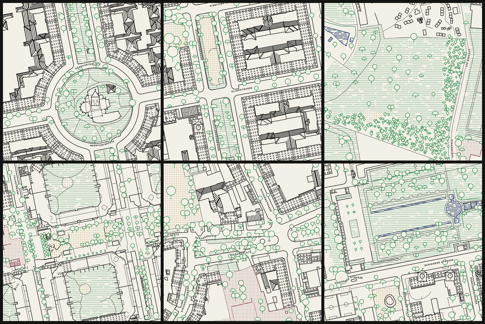
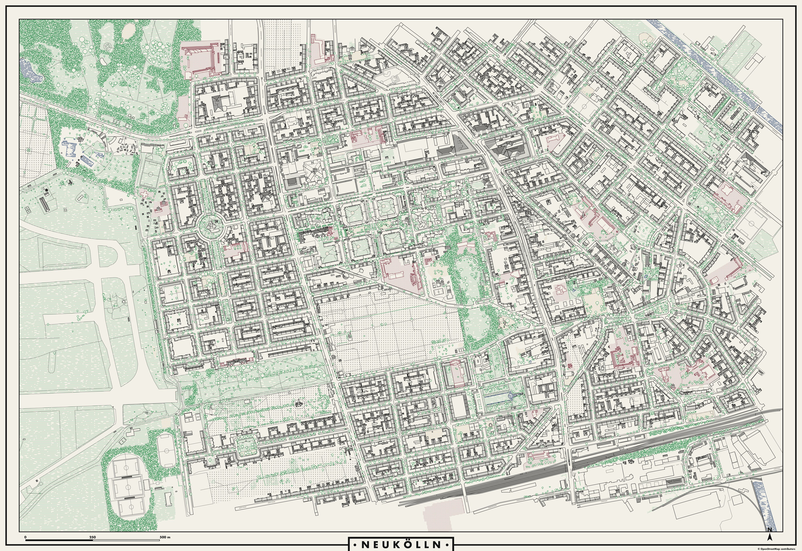

# Exploration 03 — Bold-line print



_Current state: rendered by `srk-render --layers bold` directly from PostGIS ([`style_bold.rs`](../../../rust/srk-render/src/style_bold.rs), folded facades in [`style_bold_facade.rs`](../../../rust/srk-render/src/style_bold_facade.rs)). Scenes at full size: [`scenes/`](scenes/). The briefing that started it, with the reference analysis and the folding proposal: [`briefing.md`](briefing.md)._

## Mission statement

> **The Straßenraumkarte as a screen print of Neukölln: thick lines on off-white paper, drawn with ruler and compass, where every street is a stage lined with flat house fronts.**
>
> Tone is never grey; it comes from how close parallel lines stand. Curves are circles and arcs only. The street fronts are **folded down onto the map**, away from the street onto their own building, so a street reads like the row of gabled houses in a Guémar print. Black carries the city; trees, schools and playgrounds are printed in their own calm inks, water in dark blue. Like 01 and 02 it is **rendered automatically** from OSM data, seamless across tiles.

This style is meant as a **fine print, not a zoomable map**: the data extent at z19 is A0 landscape at ~300 dpi. Generalised overview zooms come later.

## The print



Whole data extent at z19: 15,616 × 10,496 px (~0.18 m/px). For the print the pen is thicker, `SRK_BOLD_W=5` (0.42 mm at 300 dpi); the default `W = 3` at z19 reads like a technical drawing on A0. Details at 100 %: [Schillerpromenade](detail-schillerpromenade.jpg) · [Herrfurthplatz area](detail-herrfurthplatz.jpg) · [Richardplatz](detail-richardplatz.jpg) · [Körnerpark](detail-koernerpark.jpg).

```bash
export DB_HOST=localhost DB_PORT=5433 DB_USER=postgres DB_NAME=strassenraumkarte PGPASSWORD=postgres
SRK_BOLD_W=5 rust/srk-render/target/release/srk-render --bbox 13.4118,52.4673,13.4531,52.4838 \
  --layers bold --format png --zmin 19 --zmax 19 --gutter 1 --workers 8 --metatile 4 --quiet --out /tmp/bold/tiles
python3 docs/design-research/tools/bold_sheet.py /tmp/bold/tiles /tmp/bold/neukoelln-a0.png \
  --jpg docs/design-research/03-bold-line-print/map-sheet-neukoelln.jpg --jpg-width 4000   # needs Pillow
```

~20 s for 2,501 tiles, ~6 s for stitching and layout (double frame, "• NEUKÖLLN •" plate, scale bar, north mark). The full-size PNG (~55 MB) is not committed.

## What is drawn

| Element | Implementation |
| --- | --- |
| Paper, inks | Paper `#F3F0E8`, ink `#141414`; trees `#2F8F4E`, schools and kindergartens `#7B2D3B`, playgrounds `#A8741C`, water `#1F3A6B` — about equally dark, none a signal colour |
| Pens | `W` by zoom (z17 1.5, z18 2, z19 3, z20 4 px; `SRK_BOLD_W` overrides), `F = W/2` for detail. Buildings, streets, water banks and walls all in `W`. Square caps, mitre joins (checked on the Guémar print: square ends, not round marker tips). No grey, no opacity, no blur |
| Streets | Touching `highway_area` polygons of one group read as one surface: outlines stroked at 2 × pen, then all areas paper-filled on top, so shared edges vanish. Footway group (`F`) first, carriageway group (`W`) on top keeps its kerb. Path lines are masked out where they cross areas (squares, the runways of Tempelhofer Feld). Street names in bold spaced capitals |
| Folded facades | Each street-facing edge of a `roof_mass` (outward probe 4 m, a `highway_area` within 14 m) gets its facade laid onto the building: base on the building line, eaves pointing into the block. Fold region: the street-side roof facet (keeps the straight-skeleton mitre at corners) plus a 14 m strip into the wing. Per house: storeys from `building:levels`, stepped eave, one thin party wall between houses, cornice over the ground floor, window axes every 3.6 m. Ground floor from the data: mapped entrances as arched doors (`main`, `yes`, `staircase`), wide gateways (`garage`, `parking_entrance`, `service`) or shop windows (`shop`); without an entrance the door sits on the axis of the address point (`housenumber`). Sloped roofs get stripes beyond the eave, flat roofs a parapet line. Churches do not fold. `SRK_BOLD_FOLD=off` disables |
| Roofs not folded | `roof_facet` stripes parallel to the eave: north-facing 2 W, east/west 3 W, south-facing empty; ridges and hips in `W` |
| Landmarks (z18+) | Upright elevations, painted north → south. Churches: the tallest `building:part` (≥ 15 m, < 400 m²) is the tower — drawn at its centroid with its width and `0.6 × height`, spire for pyramidal/cone/onion roofs; without such a part a generic tower. Town halls (`civic`, `public`, `townhall`, `government`): box with clock, pyramid roof, flag |
| Trees | Crown radius `0.8 × diameter_crown / 2`, ±12 % jitter. Upright where the crown misses every building (lollipop on a stem, painted north → south), else a plan circle. Needleleaved: pointed teardrop. Broadleaved by id: 60 % lollipop, 25 % dome, 15 % double crown |
| Water | Rows of small half-circle waves in world-anchored runs (z18+; straight broken stripes below), bank line, all in dark blue; canals, ponds, pools |
| Areas | Texture, no outline: lawns, parks and green strips as long horizontal green rules (`F`, period 4 W) like the fields in the panorama prints; forests as tree clusters; cemetery crosses; sand dots. Playgrounds and school grounds: dot fields without outline. Inside school and kindergarten grounds every ink pixel (buildings, roofs, facades, pitch lines) is re-inked bordeaux |
| Barriers, rail | Hedges as rows of half-circles (green), walls `W`, fences `F`; rails as two lines with ties |

Category switch: `SRK_BOLD_ACCENT` (comma list, default `tree,school,playground`; `none` prints everything black).

Seams (`tools/seam_check.sh bold`, metatile 1 vs 4): 0.007 % mean, worst tile 0.03 %.

## Decisions

| Question | Decision |
| --- | --- |
| Plan or folded facades? | Folded, away from the street onto the building (briefing mockup b). Upside-down north fronts are part of the charm |
| Zoomable map or print? | Print. z19 is the print zoom; overview zooms are a later generalisation |
| Line weights | One family (`W`) for everything structural, `F` for detail only |
| Colour | Three category inks of similar darkness instead of one signal-red accent; schools fully coloured, not just outlined; water dark blue |
| Areas | Textures instead of outlines, so lines carry the content |
| Rounded forms | Waves, domed trees, half-circle hedges, arched doors and gateways |

Iteration log: briefing 2026-10-28; first renderer, A0 sheet and landmarks 2026-10-29; feedback round 2 (seamless streets, one weight family, green upright trees, bordeaux schools, area textures); feedback round 3 (trees from data with conifers and variety, clean facade joins, facades from entrances and addresses, real church tower, wave water, hedges). Details in the git history of this folder.

## Experiment: octilinear overview zooms

`SRK_BOLD_OCTI=on` (z ≤ 17, default off) snaps outlines to 0/45/90°; `SRK_BOLD_OCTI_ROT=<deg>` turns the snap frame. On screen axes it looks broken ([`experiments/octilinear-z17.jpg`](experiments/octilinear-z17.jpg)): Neukölln's grid is ~20° off, so every edge becomes a staircase. With the frame turned −20° ([`experiments/octilinear-rot-z17-clean.jpg`](experiments/octilinear-rot-z17-clean.jpg)) the regular Schillerkiez gets better, mixed street angles stay ragged. Not kept as a default; a real generalisation needs a street-aligned frame per district and its own building simplification.

## Open

- Facades on curved fronts (Herrfurthplatz) break into short segments; the eaves zigzag.
- The church tower stands on its own roof plan, so roof facets show underneath; the church has no nave in elevation yet.
- Waves are small at `W = 3`; they read well at the print pen `W = 5`.
- Hedge bumps change side where a hedge turns.
- Tempelhofer Feld makes the sheet heavy on the left; a print would crop it.
- Rounded forms not done yet: bridge arches over the canal, apses and rose windows on church elevations, roundabouts and kerb radii as true arcs, half-circle bushes on shrub areas, a sun or compass rose on the sheet.
- Labels are not placed against the heavy lines; the screen-print edge texture is not done.

## References

- [`briefing.md`](briefing.md): mission, reference analysis, style attributes, mapping table and the folding proposal as discussed before implementation; mockups in [`mockups/`](mockups/).
- [`references/README.md`](references/README.md): the 23 inspiration photos (screen prints signed VALGAL and a Vosges–Rhine wall panorama) and what each contributes. The images stay local in `references/user/` (gitignored).
- Sibling explorations: [01 — Landscape-architecture plan](../01-landscape-architecture/README.md), [02 — Fantasy-book ink map](../02-fantasy-ink-map/README.md); roof data: [ROOF-SHAPES.md](../ROOF-SHAPES.md).
