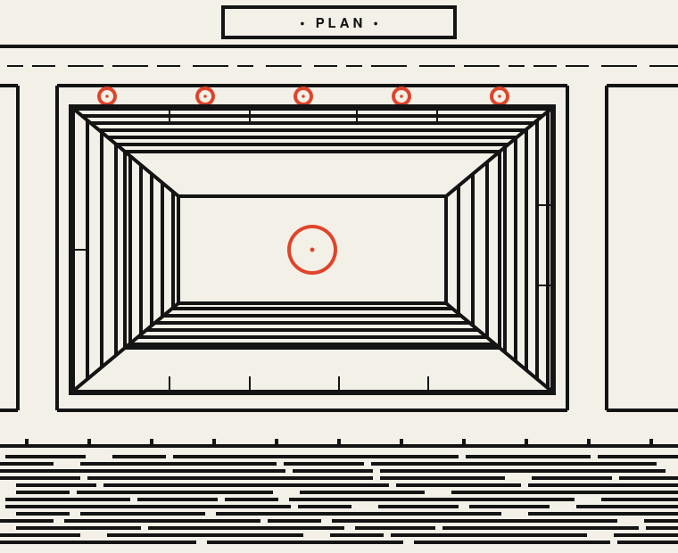
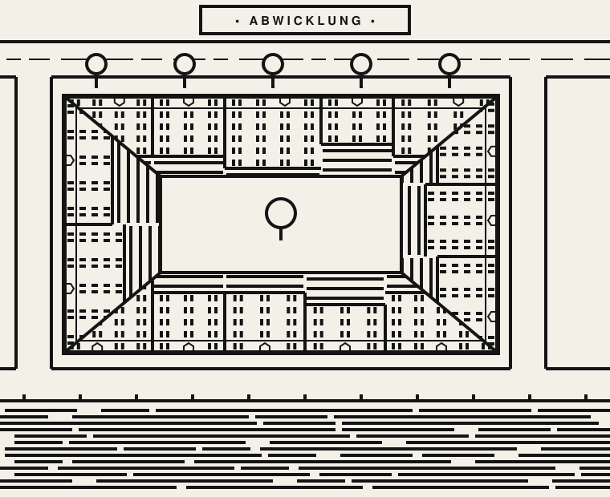
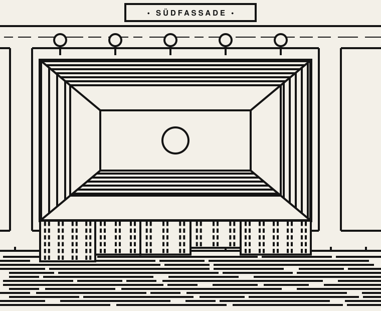

# Exploration 03 — Briefing (2026-10-28)

_The briefing as it was written and discussed before any code existed. Decisions taken since then (print zoom z19, category inks instead of one vermilion accent, one line-weight family, area textures without outlines) are in [README.md](README.md); where the two disagree, the README is current._

| (a) Plan | (b) Facades folded away from the street | (b′) South facades hung over the street |
| --- | --- | --- |
|  |  |  |

_Hand-built SVG mockups of a made-up perimeter block ([`mockups/make_mockups.py`](mockups/make_mockups.py))._

## Mission statement

> **The Straßenraumkarte should look like a screen print of Neukölln: thick black lines on off-white paper, built from rulers and a compass, where every street is a stage lined with flat house fronts.**
>
> The drawing has almost one line weight. Tone is never grey; it comes from how close parallel black stripes stand. Lines run horizontally and vertically wherever the data lets them; diagonals are rare and come from roofs, mitres and the street grid itself. Curves are circles and arcs only. In the first direction (a) this is just a line treatment of the plan. In the second (b) the house fronts are **folded down onto the map**, so a street reads like the row of gabled houses in a Guémar print. One category at a time may be printed in a **second ink** (vermilion); the rest stays black and white. As in 01 and 02, the result must be **rendered automatically** from OSM data, seamless across tiles, without hand work.

The three guiding questions:

1. **What is the line grammar?** One weight, stroke = gap, rulers and compass (below: style attributes).
2. **What folds up, and where to?** Plan (a) or facades folded onto their own footprint (b); see the fold proposal.
3. **How does the spot colour work?** One category, as line, never as a large fill.

## What the references show

23 photos by Tobias (local only, see [references/README.md](references/README.md)). Most are framed screen prints signed VALGAL (Alsace towns: Obernai, Guémar, Saint-Louis, Strasbourg, Orschwiller, Mutzig, Haguenau, Mulhouse); one is a long wall panorama from the Vosges to the Rhine (IMG_3392–3397); two are large black-and-white paintings (IMG_4531, IMG_4539). They were described in four batches by Haiku subagents and checked against the images.

| Observation | Seen in | What it means for the map |
| --- | --- | --- |
| **One line weight** for nearly everything (outline, window, roof, water); the frame is 1.5–2× heavier; at most a second, finer weight for mullions | all | One main stroke `W` per zoom, one fine stroke `F = W/2`, one heavy stroke `1.5 W`. No hairlines. |
| **Tone = stripe density, never grey.** Stripes have the same weight as outlines; dark areas are stroke = gap | Guémar sky, Strasbourg sky, Obernai roofs, IMG_4539 | Hatching periods of 2 W (dark), 3 W (medium), 4 W (light). No grey fills, no opacity. |
| **Broken horizontals:** sky, water and ground are long horizontal lines cut into dashes of irregular length | Guémar, Mutzig, panorama, IMG_4542 | Water is horizontal stripes cut into world-anchored dashes. This is the signature texture. |
| **H/V first, few diagonals.** Roofs 30–60°, spires steeper; 45° in lattices and mitres | all | Decoration (hatching, windows, labels) on screen or object axes; diagonals only where geometry demands. |
| **Compass curves:** full circles (sun, trees), semicircles (arches, domes, bushes), flat-based cloud arcs | Saint-Louis, IMG_3408, Orschwiller, panorama | Symbols are circles and arcs with quantised radii. No freehand curves, no Béziers. |
| **Depth by overlap only**, no vanishing point; front shapes knock out what is behind | all | Painter's order north → south for upright symbols; paper fill under every symbol. |
| **Windows as bars:** pairs of vertical bars, small squares or grids; one row per storey | Guémar, Strasbourg, Saint-Louis | Window rhythm from `building:levels` and facade length (see fold proposal). |
| **Facets with stripes in different directions** make a roofscape | Obernai, IMG_4539 | `roof_facet` hatched parallel to its eave, density by aspect. |
| **Spot colour is tiny:** a red sun ring, a red disc, a few red dashes on the water | IMG_3408, Strasbourg | Accent as stroke colour of one category; at most a small solid disc. |
| **Left out:** materials, shadows, people, cars, most street detail; the frame and a caption plate carry the name | all | Car and furniture detail only from z19; labels in rectangular plates. |

## Style attributes

### Ink and paper

| Token | Value | Note |
| --- | --- | --- |
| Paper | `#F3F0E8` | off-white, a touch warmer than LA's `#EAE9E3`, much cooler than ink's parchment |
| Ink | `#141414` | "pure black" by eye; true `#000` looks digital on screen |
| Accent | `#E0442A` | vermilion, the red sun of the prints |
| Print edge | off by default | optional world-anchored edge roughness (the screen-print "bite"); see open questions |

### Line weight scale (px on 256 px tiles)

The weight grows more slowly than the geometry (× ~1.4 per zoom instead of × 2), so the drawing gets airier as you zoom in and coarser as you zoom out. Below z17 detail is **removed**, not thinned.

| Zoom | W (main) | F (fine) | Heavy (1.5 W) | Hatch periods dark / medium / light | What is drawn |
| --- | --- | --- | --- | --- | --- |
| 15 | 1.0 | — | 1.5 | water only, 3 px | block outlines (`roof_mass`), carriageway edges, water stripes, parks as outline |
| 16 | 1.25 | — | 2 | water only, 3.5 px | + railway combs, single tree circles in parks |
| 17 | 1.5 | 0.75 | 2.25 | 3 / 4.5 / 6 px | + roof facets hatched, street trees, (b) eave lines and storey lines |
| 18 | 2 | 1 | 3 | 4 / 6 / 8 px | + party walls, (b) window bars, kerbs at crossings, fences |
| 19 | 3 | 1.5 | 4.5 | 6 / 9 / 12 px | + window pairs and doors, furniture, play equipment, pitch markings |
| 20 | 4 | 2 | 6 | 8 / 12 / 16 px | + mullions in `F`, parked cars (variant) |

Rules:

- Caps **butt**, joins **miter** (limit 4). Round joins only inside arcs. Corners stay sharp, as in the prints.
- Minimum hatch period 3 px; below that a hatch is dropped, not thinned (moiré).
- Dash vocabulary: lengths from {4, 6, 10, 16, 25, 40} × W, gaps W or 2 W, now and then a long gap of 6 W. Chosen from a hash of the world position (row index and x in EPSG:3857 metres), so tiles stay seamless.
- Never more than these three weights in one tile.

### Angles

- **Geometry stays true.** Neukölln's streets are not on a grid; the outlines from OSM keep their angles. Forcing them onto H/V would break the map.
- **Decoration follows two frames only:** the screen (water stripes, labels, symbols, upright trees) or the object (roof stripes parallel to the eave, windows along the facade).
- **Diagonals** come only from geometry, roof facets and mitres at block corners.
- Open: an **octilinear generalisation** (0/45/90° only, like a metro map) for z ≤ 16, which would make the low zooms look much more like the prints.

### Curve vocabulary

| Shape | Use |
| --- | --- |
| Circle, radius from {1.5, 2.5, 4, 6} × W | tree crown (plan and upright), sun-like markers, bollards, roundabout islands |
| Semicircle on a baseline | bushes and hedges (row of half circles), arches over doors, domes |
| Flat-based arc cluster (2–4 arcs) | shrubs, forest edge, the cloud motif for a legend or sheet |
| Quarter arc | rounded frame corners, kerb radii where the data curves |

Curved data (kerb radii, roundabouts, curved paths) stays as mapped; an optional later step fits circular arcs to curved runs so they read "compass-drawn".

### Fills

- **No flat grey or tint anywhere.** Black areas only for small solids (bollard tops, door blacks, the caption plate).
- Water: horizontal broken stripes, period 2 W (stroke = gap), clipped by a heavy bank line.
- Roof facets (a): stripes parallel to the eave; north-facing 2 W, east/west 3–4 W, south-facing empty paper. This replaces the light model of 01/02 with a pure stripe code.
- Lawns and parks: empty paper with a heavy outline; optional sparse short horizontal dashes.
- Sand and playgrounds: dots on a grid (the only stipple).
- Paving: empty; pedestrian areas get a joint grid in `F` from z19.

### What stays plan, what folds up

| Element | (a) Plan | (b) Folded |
| --- | --- | --- |
| Ground: streets, sidewalks, water, lawns | plan | plan |
| Buildings | outline + hatched roof facets | street-facing facades folded onto the footprint; rest roof stripes |
| Landmarks (church, school, town hall) | outline + hatched facets + small upright icon | upright elevation icon in the vocabulary of the prints |
| Trees | circle + centre dot | upright lollipop (circle on stem), painted north → south |
| Furniture, play equipment | plan glyphs | plan glyphs (upright only for lamps) |

## Mapping to the pipeline

Table names as used by the 01/02 renderers.

| Data (OSM / processed table) | Line treatment |
| --- | --- |
| `building` outlines | heavy outline `1.5 W` around the mass; party walls as `F` ticks (a) or full-height `F` lines on the facade (b) |
| `building:part` (in `building`, `building_parts`) | (a) inner `F` lines; (b) height steps in the eave line |
| `building:levels`, `height` (93 % coverage on outlines) | (b) number of storeys = rows of windows; fallback `height / 3.2`, then 5 |
| `roof_mass`, `roof_facet`, `roof_shape_line` (`roof_shape.sql`) | (a) facet stripes by aspect, ridge in `W`, hips/valleys in `W`; (b) facet polygons are the clip regions of the folded facades, the mitre lines are the hip/valley edges |
| landmarks (`amenity=place_of_worship`, `building=church\|school\|townhall`) | upright elevation icon: spire, bell turret, clock; one per building |
| `highway_area` carriageways | two kerb lines in `W`, paper inside; centre line broken in `F` |
| sidewalks / footways | paper between kerb and building line; joint ticks in `F` at z19+ |
| cycleways | dashed `F` line along the lane |
| `path` in parks | double line in `F` (z17+), single `W` below |
| crossings, road markings | zebra as bars of stroke = gap; other markings dropped below z19 |
| `water_body`, `waterway` | heavy bank line, horizontal broken stripes inside |
| `landuse` grass / park / cemetery | outline only; cemetery: small crosses on a grid |
| `landuse` forest | cluster of circles (broadleaf) and triangles (conifer, `leaf_type`), front cuts back |
| `tree` (incl. `diameter_crown`, `leaf_type`) | circle, radius quantised from `diameter_crown`; conifer as triangle |
| hedges / walls / fences (barrier lines) | row of semicircles / heavy line with teeth (crenellation) / `F` dashed line with posts |
| `railway` | comb: two rails in `W`, ties in `F` |
| `bridge` | paper deck, parapets in heavy, semicircle arches on the side over water |
| benches, bins, lamps, bicycle stands (point features) | bar with two legs, small square, circle on stem, row of U-shapes |
| `playground_polygon` / sandpits / equipment | dot grid, arcs for swings and slides |
| `pitch_markings` | lines in `F` |
| `street_parking_point` (variant `SRK_CARS=on`) | rectangles with two window bars, z19+ |
| entrances (`entrance=*` points on outlines, imported per `osm_import.lua`; table to be checked) | (b) door arch on the ground floor at the mapped position |
| `label_highway`, place names | bold geometric sans, spaced capitals; candidates: along the street, or inside a rectangular plate |

## The two directions

### (a) Plan view, line treatment only

The current plan, redrawn in the grammar above: heavy block outlines, roof facets as stripes in different directions (the Obernai roofscape and the IMG_4539 painting are exactly this), water as broken horizontals, trees as circles.

| Pro | Contra |
| --- | --- |
| Nothing hides anything; every street and sidewalk stays readable | Loses most of what makes the prints special: the house fronts |
| Works from z15 to z20 with one rule set; seamless is easy | Close to 02's ink plan; the difference is "graphic" vs "hand-drawn" |
| Reuses `roof_facet` directly; no new SQL | Facet stripes on 1,500 masses can get busy at z17 |
| Cheap to render | — |

### (b) Folded facades ("umgeklappt")

The street-facing fronts are laid flat and drawn as elevations in the grammar of the prints: stepped eave line, storey rows of window bars, doors, roof stripes behind the eave.

| Pro | Contra |
| --- | --- |
| The expressive identity Tobias is after; a street reads like a Guémar row | Only from z17 (eave + storey lines), real windows from z18 |
| Uses data we have: `building:levels` (93 %), skeleton facets, entrances | Facades on the north side of a street are upside down, east/west ones sideways — the logic of a child's drawing (charm or problem: open question) |
| Dense rows become one calm band, not a pile of 3D boxes | Courtyards and back roofs lose their roof drawing |
| Seamless: everything is anchored to the mass and its edges | Needs a "street-facing edge" classification and a height compression (below) |

## Proposal for folding (b)

**Fold away from the street, onto the building itself** (mockup b). Each street-facing edge of a `roof_mass` gets its facade drawn with the **base on the building line** and the eaves pointing **into the block**. Nothing ever covers a street or sidewalk; both sides of every street show their fronts. This is the "Straßenabwicklung" of an architect's street elevation, laid onto the plan.

The alternative, **fold towards the viewer (south)** (mockup b′), hangs every south front over the street in front of it, as 02 does with its narrow south band. North fronts disappear, the street south of each block is half covered, and the effect is strongest on east–west streets only. Recommended as the comparison, not the main line.

Construction (all from existing tables):

1. **Street-facing edges.** An edge of a `roof_mass` faces a street when its outward normal reaches a carriageway or footway within ~8 m (sidewalk width). Courtyard rings (holes) and edges against yards or neighbours stay plan.
2. **Clip region.** The fold region of an edge is its wing: from the street edge to the courtyard edge, cut at the corners by the straight-skeleton hips and valleys. That is the union of the outer and inner `roof_facet` of that side. Corner buildings get a mitre, as in a picture frame (the 45° diagonals in mockup b).
3. **Height compression.** A Gründerzeit wing is ~13 m deep and ~17 m high; the facade does not fit at true scale. Use **one storey height per zoom** for the whole map (so rows line up), e.g. `storey = min(3.2 m, wing_depth / max_levels_on_street)`, clamped to ≥ 2.2 m; masses that still do not fit are compressed on their own. What is left above the eave is drawn as roof stripes parallel to the eave.
4. **Dense rows.** One continuous band per street side per mass. Individual houses appear only as full-height party-wall lines in `F` and as **steps in the eave line** where `building:levels` differ. No per-house boxes, no occlusion — this follows the decision that dense rows must not become messy 3D.
5. **Window rhythm.** Storeys = `building:levels` (fallback `height / 3.2`, then 5). Window axes every ~3.6 m along the facade (Gründerzeit axis spacing), at least one per house; `n = round(length / 3.6 m)`, centred in each house segment. Glyph by zoom: z18 one bar per window; z19 a pair of bars, door arch on the ground floor (at the mapped entrance, else the middle axis); z20 framed windows with `F` mullions. A glyph family (bars, squares, arched tops) is picked per building from a hash of its OSM id, so rows are lively and stable across tiles.
6. **Ground floor.** Shops (shop/amenity points inside the building) turn the ground floor into wide openings; otherwise windows like the upper floors.
7. **Solitaires and towers.** A free-standing building folds all its street-facing sides the same way. Where the footprint is too small for the storeys (towers ≥ 8 levels), only storey lines are drawn: the striped tower of the Mulhouse print.
8. **Landmarks** do not fold: they stand upright as elevation icons and are the only real occluders, painted north → south with trees.
9. **Down-zoom.** z17: eave line + storey lines only; z16 and below: plan as in (a).

## Spot colour

- One category per render, as in 02: `SRK_ACCENT` = `tree`, `playground`, `bench`, `cars`, plus new candidates `school` and `water`.
- The accent **replaces the ink of that category's strokes** (outline, windows, stripes). Allowed: one small solid disc or bar per feature. Not allowed: large fills, two accent categories at once, accent on labels of other categories.
- `school` in (b): the whole folded facade of the school drawn in vermilion is the strongest single use of the second ink.
- `water`: stripes in vermilion would mimic "red dashes on the river" of the Strasbourg print, but turns the canal into the loudest thing on the map; test before deciding.

## Open questions for Tobias

1. **(a) or (b) first?** Proposal: (a) as the base for all zooms, (b) on top from z17.
2. **Fold direction:** away from the street onto the footprint (recommended) or towards the viewer (south)? Are upside-down north fronts charming or confusing?
3. **One weight or two?** The prints are almost monoline. Is `F` for mullions, centre lines and dashes acceptable, or should everything be `W`?
4. **Octilinear low zooms:** snap the street network to 0/45/90° at z ≤ 16 for a poster look, or keep true geometry everywhere?
5. **Pure black or near-black?** `#141414` on `#F3F0E8`, or `#000` on `#FFF` for print?
6. **Screen-print edge:** clean vector edges, or a slight world-anchored roughness like the prints?
7. **Labels:** spaced capitals along the street, or rectangular caption plates (the VALGAL motif)?
8. **Trees:** circles in plan for (a), upright lollipops for (b) — or upright everywhere?
9. **First accent category:** trees, schools or playgrounds?
10. **Storey height:** one storey height for the whole map (calm rhythm) or per mass (more faithful, more restless)?
11. **Courtyards in (b):** keep the courtyard-side roof stripes, or leave courtyards empty paper?

## How the mockups were made

[`mockups/make_mockups.py`](mockups/make_mockups.py) writes the three SVGs from one invented perimeter block (four wings, 2–5 houses each, 4–6 storeys) with a street on three sides and a canal in the south. The ring's skeleton is drawn by hand (ridge ring and mitres), not computed. Render to PNG with `resvg file.svg out.png`.

## References

- [references/README.md](references/README.md): list of the 23 photos and what each contributes. The images stay local in `references/user/` (gitignored).
- Sibling explorations: [01 — Landscape-architecture plan](../01-landscape-architecture/README.md), [02 — Fantasy-book ink map](../02-fantasy-ink-map/README.md); roof data: [ROOF-SHAPES.md](../ROOF-SHAPES.md).
