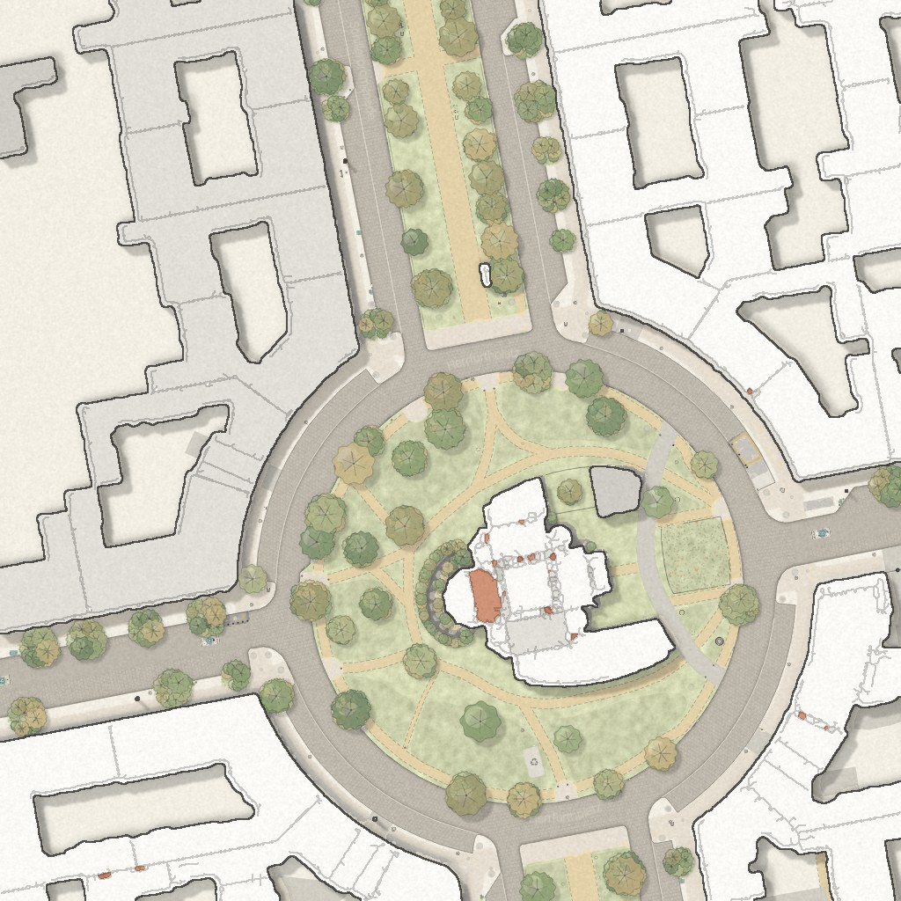
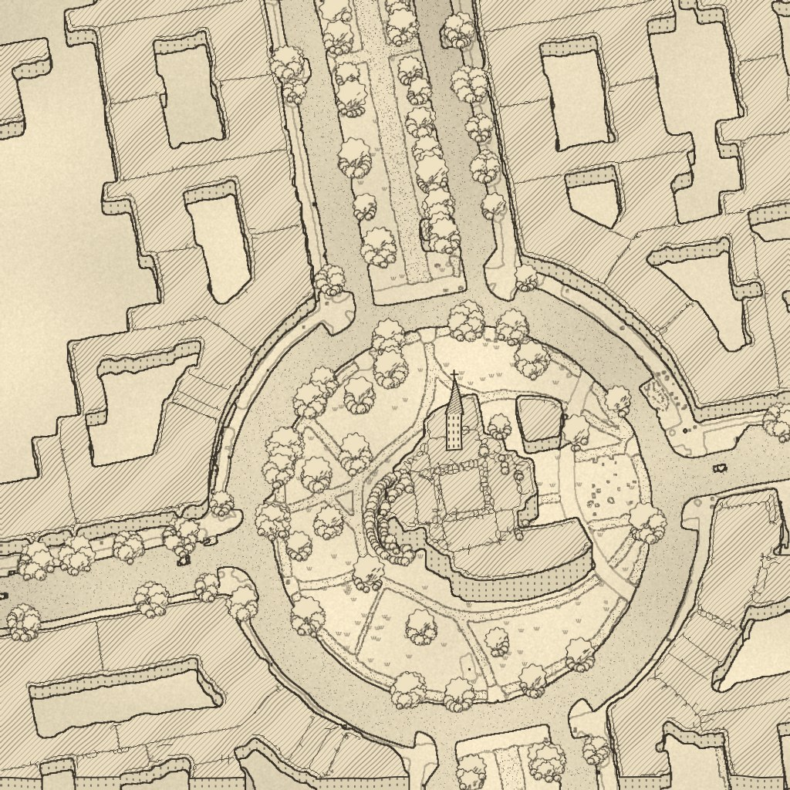

# Design research: two style explorations

Two alternative looks for the Straßenraumkarte, each with a mission statement, style attributes, research notes, reference images and target pictures. The goal of both is a style that the **pipeline renders directly** (SQL + QGIS) from OSM data. The mockups here are only target pictures to steer that work.

| | Exploration | Mission in one line |
|---|---|---|
|  | [01 — Landscape-architecture plan](01-landscape-architecture/README.md) | A site plan a landscape architect drew for the street: earthy pastel ground, illustrated tree symbols, crisp white/grey buildings with the occasional red roof. |
|  | [02 — Fantasy-book ink map](02-fantasy-ink-map/README.md) | A hand-drawn ink map from a fantasy novel: plan-view ground, upright houses, landmarks and trees, monochrome with one category highlighted in an accent colour. |

## Layout

```
docs/design-research/
├── README.md                     this overview
├── scenes/                       today's rendering of the four test scenes (input for mockups)
├── tools/                        scripts to rebuild scenes and mockups
├── 01-landscape-architecture/
│   ├── README.md                 mission statement, attributes, pipeline mapping, prompts
│   ├── research-notes.md         full research: palette, line weights, tree vocabulary, 25 references
│   ├── mockups/                  target pictures (+ overview.jpg: today vs target)
│   └── references/               README committed; web/ and user/ images stay local (.gitignore)
└── 02-fantasy-ink-map/           same structure
```

## How to work on an exploration

1. Read the exploration's README (mission statement first) and its research notes.
2. Add own screenshots to `references/user/` and note them in `references/README.md`.
3. Change the QGIS style / SQL towards the target and render the four scenes (same tile ranges as in [`scenes/README.md`](scenes/README.md)).
4. Compare against `mockups/` and commit a before/after step folder with a short README per step.
5. Record findings and gotchas in the exploration's README.

## Rebuilding the scenes and mockups

```bash
python3 -m venv .venv-design && .venv-design/bin/pip install numpy scipy scikit-image pillow opencv-python-headless
.venv-design/bin/python docs/design-research/tools/make_scenes.py --tiles render/tiles --out /tmp/scenes
cd docs/design-research/tools
../../../.venv-design/bin/python restyle_mockup.py la  /tmp/scenes/a-herrfurthplatz.png ../01-landscape-architecture/mockups/a-herrfurthplatz.jpg
../../../.venv-design/bin/python restyle_mockup.py ink /tmp/scenes/a-herrfurthplatz.png ../02-fantasy-ink-map/mockups/a-herrfurthplatz.jpg --landmark
```

The scenes need tiles at z19 for the Schillerkiez area (rendered from the full Neukölln extent). The colour classifier in `tools/classify.py` is tuned to the current palette and will need new thresholds if the base style changes.

## Status

- 2026-10-15: research folders, mission statements, procedural target pictures for four scenes. Research done by two subagents (web research, reference downloads), mockups and synthesis by the main session. No AI image generation was available; prompts for it are in each README.
