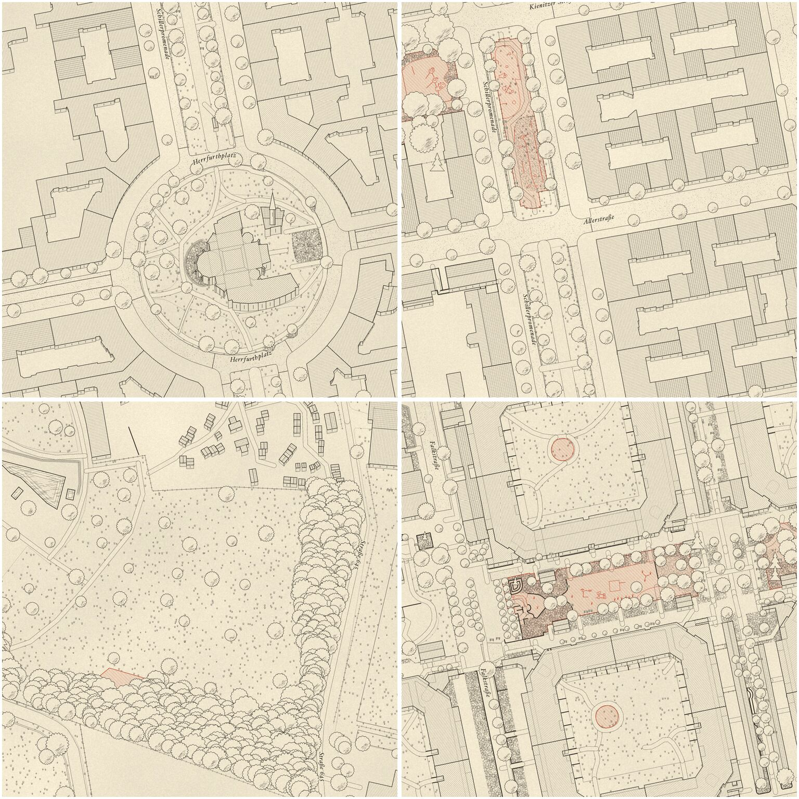

# Design research: two style explorations

Two alternative looks for the Straßenraumkarte, each with a mission statement, style attributes, research notes, reference images and — since the night of 2026-10-15 — a **working renderer** in `rust/srk-render` that draws the style directly from PostGIS.

| | Exploration | Mission in one line |
|---|---|---|
|  | [01 — Landscape-architecture plan](01-landscape-architecture/README.md) · `srk-render --layers la` | A site plan a landscape architect drew for the street: cool sage/khaki ground, illustrated tree symbols, calm white buildings with a crisp outline and the odd red roof. |
|  | [02 — Fantasy-book ink map](02-fantasy-ink-map/README.md) · `srk-render --layers ink` | A hand-drawn ink map from a fantasy novel: plan-view city with hatched roofs, upright trees and landmarks, monochrome with one category lifted out in an accent ink. |

## Decisions so far

| Question | Decision | Why |
| --- | --- | --- |
| Which renderer? | **Rust (`srk-render`)**, new presets `la` and `ink` next to `full-approx` | Both styles are pixel craft (hatching, jitter, blur, painter's order, textures). In Rust every stroke is code we can iterate on and judge from rendered images; QGIS would need expression/geometry-generator gymnastics, MapLibre cannot do the raster effects. 64 tiles render in ~2.5 s. |
| Seamless tiles? | All randomness is seeded from **world coordinates** (EPSG:3857 metres) or OSM ids; densities use a zoom-scaled world cell (`zcell`) | Neighbouring tiles and metatiles produce identical pixels at their shared edge. |
| Ink: houses in 3D? | **No.** Plan view + roof hatch along the slope + ridge + cross-hatched shaded roof half + narrow south facade band (z18+). Only landmarks and trees stand up. | Tobias: dense rows of houses would collide in an oblique view. The roof treatment gives volume without occlusion. |
| Ink: accent colour | One category per render: `SRK_ACCENT` = `playground` (default), `bench`, `tree` or `none` | Requirement: highlight one category, rest stays black-and-white ink. |
| LA: palette | Swatches from Tobias's Pinterest board (`#EAE9E3 #CBD4BC #A6A48C #85835F …`) | The first mockup was too yellow/earthy; the board is cooler and greyer. |

## Layout

```
docs/design-research/
├── README.md                     this overview
├── NIGHT-2026-10-15.md           report of the overnight iteration run
├── scenes/                       the four test scenes: QGIS today, Rust full-approx baseline
├── tools/                        render_scenes.sh, save_step.sh, mockup scripts
├── 01-landscape-architecture/
│   ├── README.md                 mission statement, attributes, pipeline mapping
│   ├── current.jpg               latest rendering of the four scenes
│   ├── steps/NN-…/               one folder per iteration: sheet.jpg, detail*.jpg, README.md
│   ├── research-notes.md         full research: palette, line weights, tree vocabulary, references
│   ├── mockups/                  first target pictures (image post-processing, superseded)
│   └── references/               README committed; web/ and user/ images stay local (.gitignore)
└── 02-fantasy-ink-map/           same structure
```

## Rendering the styles

Needs the PostGIS database with processed Straßenraumkarte tables (for the scenes: the Schillerkiez bbox is enough, see below) and a release build of `srk-render`.

```bash
# one-time: DB for the scene area (Docker stack from docker/README.md; ~1.5 min, 43 MB)
BBOX=13.4102,52.4707,13.4370,52.4832 ./docker/run-berlin.sh
(cd rust/srk-render && cargo build --release)

# the four scenes at z19 (or 16–18 as third argument) → PNG tiles + stitched scenes
docs/design-research/tools/render_scenes.sh la  /tmp/la
docs/design-research/tools/render_scenes.sh ink /tmp/ink
SRK_ACCENT=bench docs/design-research/tools/render_scenes.sh ink /tmp/ink-bench

# any area / zoom range, like the production farm
DB_PORT=5433 PGPASSWORD=postgres rust/srk-render/target/release/srk-render \
  --layers ink --bbox 13.4132,52.4715,13.4312,52.4821 --zmin 16 --zmax 19 --format webp --out /tmp/ink-tiles
```

Code: [`style_la.rs`](../../rust/srk-render/src/style_la.rs), [`style_ink.rs`](../../rust/srk-render/src/style_ink.rs), shared helpers (queries, world noise, masks, hatching, wobble, blur, labels) in [`style_kit.rs`](../../rust/srk-render/src/style_kit.rs).

## How to work on an exploration

1. Read the exploration's README (mission statement first) and its research notes.
2. Add own screenshots to `references/user/` and note them in `references/README.md`.
3. Change `style_la.rs` / `style_ink.rs`, render the scenes, look at them.
4. Save the iteration with `tools/save_step.sh <exploration> NN-slug <render-dir> <readme.md>` and commit code + step folder together.
5. Record findings and gotchas in the exploration's README.

## Status

- 2026-10-15 (day): research folders, mission statements, image-processing mockups for four scenes.
- 2026-10-15/16 (night): both styles implemented in Rust and iterated in steps (see `steps/` and [NIGHT-2026-10-15.md](NIGHT-2026-10-15.md)).
