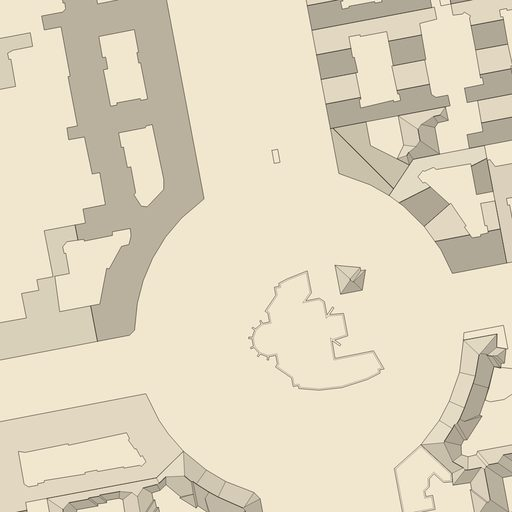
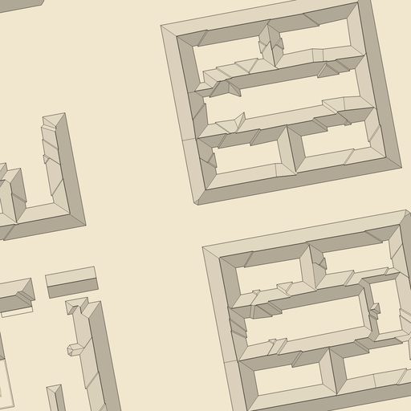
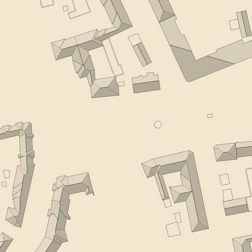

# Roof shapes for the design-research styles

Branch `claude/design-roof-shapes-5961f4`. Scope: research, a data probe, and a working prototype of roof geometry (ridges, hips, gables, facets) built in SQL from OSM footprints and rendered by a preview preset. Section 8: integration into the `ink` and `la` styles (done after merging).

## 1. Summary

- **Built:** `data/processing/sql/roof_shape.sql` creates three tables from building outlines: `roof_mass` (one roof per group of touching buildings), `roof_facet` (planes with compass aspect) and `roof_shape_line` (ridge, hip, parapet). Hooked into `data_preparation.sh` right after `building.sql`.
- **Method:** touching outlines of the same roof kind are merged into one mass, the mass is closed and simplified, and hipped roofs come from the **straight skeleton** (SFCGAL `CG_StraightSkeleton`). Gabled roofs are a **centreline split** of the oriented envelope. Flat roofs get a parapet line.
- **Works:** courtyard blocks (holes) and Gründerzeit rows read as roofs in plan: hips at corners, ridges along the wings, slopes into the courtyard. Tagged pyramids and gables read correctly. No skeleton failures on the Schillerkiez bbox.
- **Does not (yet):** L-shaped gables are replaced by hips rather than gabled properly; skillions are treated as flat because `roof:direction` is not imported.
- **Runtime:** about 65 s for the whole bbox on first run; later runs took 4–6 min on the shared dev DB while other sessions were busy (measured, not optimised).

## 2. Data coverage (dev DB, Schillerkiez–Körnerpark bbox, 2026-10-16)

`building` holds 6,014 rows: **3,505 outlines** (`building` set) and **2,509 `building:part`** volumes. Parts have no `building` value, so `building IS NOT NULL` selects outlines.

| Item | Count | Share |
| --- | --- | --- |
| Outlines, excluding `building=roof` canopies (120) | 3,385 | |
| …with `roof:shape` | 577 | 17.0 % |
| …with `building:levels` | 3,149 | 93 % |
| Parts with `roof:shape` | 348 of 2,509 | 13.9 % |
| `building=roof` (canopies, skipped) | 120 | |

`roof:shape` on outlines: none 2,808 · flat 220 · gabled 132 · **double_saltbox 130** · skillion 28 · hipped 22 · saltbox 20 · pyramidal 12 · quadruple_saltbox 4 · gambrel 3 · many 2 · round 2 · cone 1 · `hipped;flat` 1.

- **Not imported:** `roof:direction`, `roof:orientation`, `roof:angle`, `roof:height`, `roof:levels`. `data/lua/osm_import.lua` imports only `roof:shape` for `building`; `roof_line` carries `roof:ridge` / `roof:edge` as lines. Adding `roof:direction` and `roof:orientation` to the Lua attribute list would make skillions and some gables exact. That needs a re-import, which this branch does not do.
- **Attached:** 3,414 pairs of outlines touch. Of 2,808 untagged outlines, about 2,550 (≈ 90 %) touch or overlap another outline. This is the Berlin situation: rows and perimeter blocks, not free-standing houses.
- **Storeys:** the untagged attached outlines are mostly 5 storeys (1,409), with 3–4 (265) and 6 (79). The Schillerkiez default is therefore 3–6 storeys = Gründerzeit.

## 3. Why per-building skeletons look wrong, and how to connect them

A straight skeleton of one house in a row gives hip ends on both party walls. Each house gets its own ridge stub, and the ridge stops at every party wall. In a real Berlin row the roof is one continuous mass: the ridge runs along the whole street front, and the party walls are invisible.

The connection step in `roof_shape.sql`:

1. Group outlines by resolved roof kind (section 5). Touching outlines of the same kind form one cluster (`ST_ClusterDBSCAN(geom, 0.01, 1)` as a window function).
2. `ST_Union` each cluster. Interior party walls disappear; courtyards stay as holes.
3. Close with a 1.2 m buffer (mitre joins) to absorb wall jogs and bay-window notches, then simplify to 0.4 m.
4. **Caps:** a cluster above 9,000 m² or 60 buildings falls back to one mass per building. On the bbox no hipped or gabled mass hit the cap; the largest hipped mass is 8,996 m².

Result on the bbox: 1,527 masses from 3,385 outlines (531 hipped masses with 1,815 buildings, 244 gabled with 382, 774 flat with 1,139; 123 masses have courtyards).

## 4. Geometry methods compared

| Method | Use | Verdict |
| --- | --- | --- |
| **Straight skeleton** (`CG_StraightSkeleton`, SFCGAL 1.4.1 in `postgis_sfcgal` 3.5.3, already installed in the dev DB) | Hipped roofs, polygons with holes | **Chosen.** Exact for rectangles and courtyard rings; supports holes (input must be CCW exterior, `ST_ForcePolygonCCW`). Facets are obtained by polygonizing boundary plus skeleton. Sensitive to jagged boundaries, hence the closing and simplification. Slowest step. |
| Approximate medial axis (`ST_ApproximateMedialAxis`, GEOS) | Ridge lines only | Not used. It yields spurs at every corner and no facet polygons, so it cannot shade planes. |
| Oriented envelope + centreline split | Gabled roofs | **Chosen for gables.** Two planes split by the centreline of the envelope's long axis; exact for rectangles, full-length ridge with gable ends; approximate for L shapes. Cheap and never fails. |
| Own decomposition into rectangles, then per-piece gable/hip | L shapes, wings | Not built. The next step if the centreline fallback looks wrong on L-shaped blocks. |

Precedents (from memory, not re-checked in this session): the OSM wiki's *Simple 3D Buildings* scheme defines the `roof:shape` / `roof:direction` / `roof:orientation` / `roof:height` tags used here. OSM-3D / OSMBuildings and F4Map build roofs from footprints with `roof:shape`; osm2world generates gable and hip roofs with skeleton-type constructions. Confirm before citing.

## 5. Sanitising rules

| Input | Rule |
| --- | --- |
| Outlines only (`building IS NOT NULL`) | Parts overlap their outline; using both would double every roof. |
| `building=roof` | Skipped (canopies have no walls). |
| Area < 8 m² | Dropped (slivers). |
| `roof:shape` flat, skillion | → **flat**. A skillion needs `roof:direction`, which is not imported. |
| gabled, saltbox, double_saltbox, quadruple_saltbox, gambrel | → **gabled** (centreline split). |
| hipped, pyramidal, mansard, round, onion, cone, dome | → **hipped** (straight skeleton; a square footprint gives a pyramid). |
| Unknown, multi-valued (`hipped;flat`, `many`) | → default rule. |
| Gabled mass with area / oriented-envelope area < 0.75 (L and U shapes) | → hipped. A centreline split on such a mass gives planes that do not read as a gable. |
| Facets under 3 m² | Merged into the neighbour with the longest shared edge (removes the bowties). |
| Default, sheds/garages, `building` in garage(s), shed, carport, service, greenhouse, storage_tank, hut, kiosk | flat |
| Default, area < 25 m² | flat |
| Default, attached, 3–6 storeys | **hipped** (Gründerzeit row or block) |
| Default, attached, 1–2 or 7+ storeys | flat (extensions, modern blocks) |
| Default, detached, area ≥ 350 m² or ≥ 5 storeys | flat |
| Default, detached, elongated (long/short ≥ 1.25) | gabled |
| Default, otherwise | hipped |
| Flat masses ≥ 150 m² | parapet line 0.5 m inside the edge |

## 6. Output tables

- `roof_mass(mass_id, kind, n_buildings, osm_ids[], geom)`: the cluster. `kind` ∈ hipped | gabled | flat.
- `roof_facet(mass_id, kind, aspect_deg, dir, geom)`: planes. `aspect_deg` is the **downslope bearing** (0 = north, clockwise), i.e. the direction the facet faces. `dir` is the 8-point label. Hipped facets: one per boundary edge, aspect from the facet's interior point to the nearest boundary point. Gabled: one per side of the centreline.
- `roof_shape_line(mass_id, class, geom)`: `ridge` (gable ridge, or a hip-skeleton edge between two facets facing ≥ 150° apart), `hip` (every other skeleton edge), `parapet`.

The table is named `roof_shape_line`, not `roof_line`, because `building.sql` reads and then drops the osm2pgsql table `roof_line`. Re-running `building.sql` after this file would otherwise import the new lines into `building_lines`.

Counts on the bbox: 15,570 facets (15,034 hipped, 536 gabled), average 6 vertices. Lines: 22,353 hip and 7,340 ridge pieces (merged per mass, but not per edge) and 364 parapets. Facet aspect is spread over all eight directions, with S 2,517 and N 2,466 leading.

## 7. Visual probe

Preview preset `--layers roofs` (new `rust/srk-render/src/roof_shapes.rs`; wiring in `layers.rs` and `main.rs`). Paper, footprints, facets tinted by the NW-light term, ridge/hip/parapet lines. It is a probe, not a style.

Rendered with `docs/design-research/tools/render_scenes.sh roofs /tmp/roofs`; scenes a, b, d and e were checked by eye. Scenes c and f rendered but were not reviewed.

| Herrfurthplatz (a) | Schillerpromenade (b) | Richardplatz (e) |
| --- | --- | --- |
|  |  |  |

- **Works:** Gründerzeit perimeter blocks (b) read as blocks with a ridge per wing and hips at the corners. Courtyard slopes inward. Tagged pyramids (a, e) and gabled strips (e) come out right.
- **Courtyard blocks (d) are flat, and that is correct for the data:** the six-storey apartment blocks there are tagged `roof:shape=flat`.
- **Does not work well:** small bowtie facets where narrow courtyard wings meet (b, centre); L-shaped gables are approximate; at z19 the ridge lines are only slightly heavier than the outlines, so a style needs a clearly heavier ridge stroke than the base line width.

## 8. How each style uses the data (integrated 2026-10-16)

**Status:** integrated in both styles — ink step 22 (`02-fantasy-ink-map/steps/22-roof-shapes`), LA step 22 (`01-landscape-architecture/steps/22-roof-planes`). Implementation: `load_roofs`, `hatch_in_polygon`, `bearing_to_screen_deg` in `style_kit.rs`; `draw_roof_facets` in `style_ink.rs`; facet tones + ridge hairlines in `style_la.rs`. From z17, `SRK_ROOFS=off` disables, automatic fallback when the tables are missing. Seam checks stay < 0.1 %. Preview of the result: `roof-shapes/integrated-ink-la-schillerpromenade.jpg` (ink without roofs · ink with roofs · LA with roofs).

**Merge note (PR #2):** the roofs branch built a second, parallel integration of the same data (`roof_shapes::load`, `draw_ink_facets`, `draw_ink_lines`, `draw_la_facets`, `draw_la_ridges`). When it was merged, the styles kept the integration above, so roofs are drawn once. The newer SQL (sliver merge, L-gable fallback, `valley` class) and the pipeline switch `ROOF_SHAPES` come from the roofs branch. The alternative drawing functions stay in `roof_shapes.rs`, used by the `--layers roofs` preview only, and are described below as an option. In the styles, the switch is `SRK_ROOFS=off`. The preview preset also accepts `0` and `false`.

The roofs branch's integration notes follow.

Switches:

| Where | Switch | Effect |
| --- | --- | --- |
| Render (`srk-render`, both styles) | `SRK_ROOFS=0` | Off: the styles draw exactly as before (ink: per-building hatch and ridge; LA: plain white volume). |
| Render | (automatic) | Off when `roof_mass` / `roof_facet` / `roof_shape_line` are missing. |
| Pipeline (`data/data_preparation.sh`) | `ROOF_SHAPES=false` | Skips `roof_shape.sql`. Default `true`. |

Shared code: `rust/srk-render/src/roof_shapes.rs`. `load()` reads facets, lines and flat masses for the tile, indexed by building `osm_id` (a building belongs to the mass that lists its id in `roof_mass.osm_ids`). Buildings with no roof data keep the old drawing.

### Ink (`style_ink.rs`, `draw_buildings`)

- **Light and shade:** ink's light comes from the south-west, so the north-east half is the shaded one (`roof_shapes::ink_shaded`: `cos(aspect − 45°) > 0`). This binary rule avoids flicker between neighbouring hip facets.
- **Hatch:** every facet gets the main hatch **along the downslope direction** (screen angle `aspect − 90°`, the same convention as `axis_px`), clipped to the building footprint. Shaded facets get a second hatch along the ridge (screen angle `aspect`, spacing ×1.3, alpha 0.38).
- **Lines:** ridge (weight `lw × 1.1`, alpha 0.9) always; hip, valley (`lw × 0.6`, 0.7) and parapet (`lw × 0.5`, 0.5) from z18.
- **Oblique mode:** facets and lines are shifted by the same lift as the roof.
- Flat masses get no slope hatch; they show a parapet line at z18+.

### Landscape architecture (`style_la.rs`)

- **Facet tone:** `SHADOW` at alpha `0.03 + 0.10 × shade`, where `shade = 1 − lit_factor` (NW light, the same light as the SE shadow). Clipped to the footprint, from z17. Peak 0.13 stays below the 0.34 shadow layer, so buildings still read white.
- **Ridge hairline:** only the `ridge` class, 0.35 px, alpha 0.5, from z18. No hips, no valleys, no parapets.

### Edge classes (`roof_shape.sql`, `roof_edge_class`)

- `ridge`: the two facets face ≥ 150° apart.
- `valley`: both facets drain towards the other's centroid (a concave crease, e.g. the inner corners of a courtyard block).
- `hip`: everything else.

## 9. Reproduce

```bash
# DB: the dev container must be running (localhost:5433)
docker exec -i strassenraumkarte-db-1 psql -U postgres -d strassenraumkarte -X -v ON_ERROR_STOP=1 < data/processing/sql/roof_shape.sql
cd rust/srk-render && cargo build --release
cd ../.. && docs/design-research/tools/render_scenes.sh roofs /tmp/roofs
```

## 10. Next steps

Done in this round: sliver merge, rectangularity fallback for gables, valley class, render switch, pipeline switch, ink and LA integration.

Still open:

1. **Lua import:** add `roof:direction` and `roof:orientation` to `building` in `data/lua/osm_import.lua`, so skillions and some gables become exact. Needs a re-import.
2. **L-shaped gables:** decompose into rectangles, then gable each. Today such masses fall back to hips.
3. **Speed:** the facet and line queries dominate; `roof_shape_line` needs an index on `mass_id`.
4. **Check at z17 and z19 with the seam check** (`docs/design-research/tools/seam_check.sh`) before merging.
