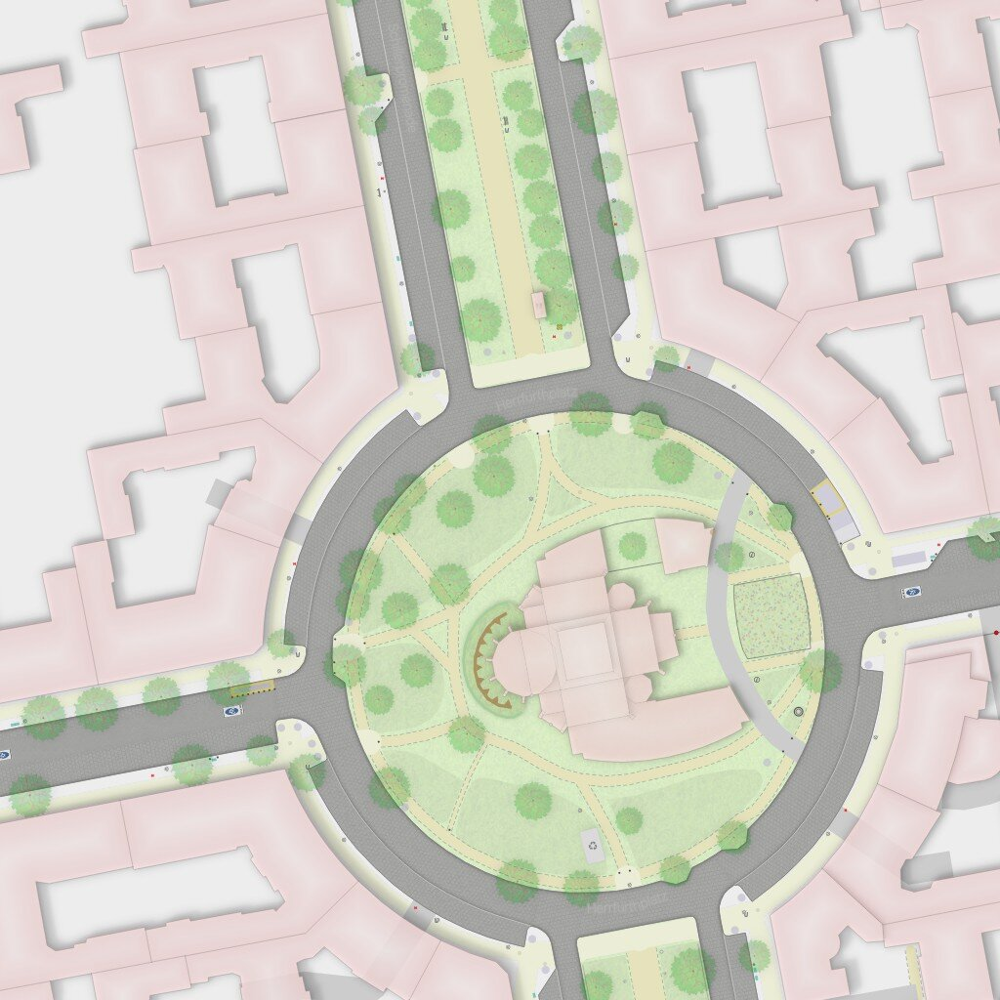
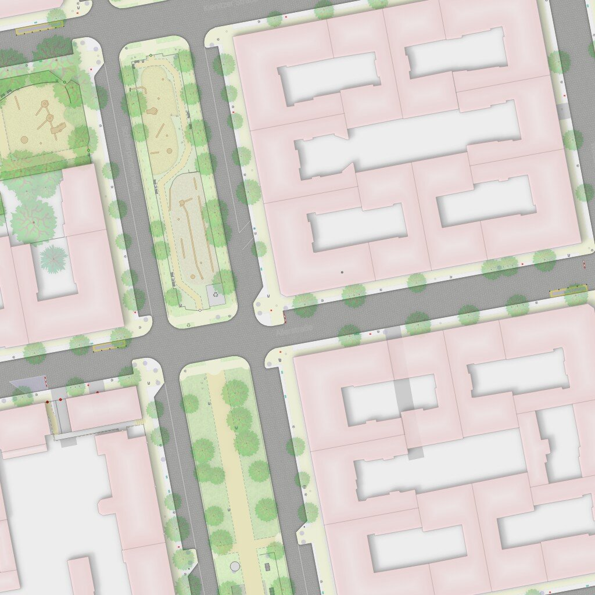
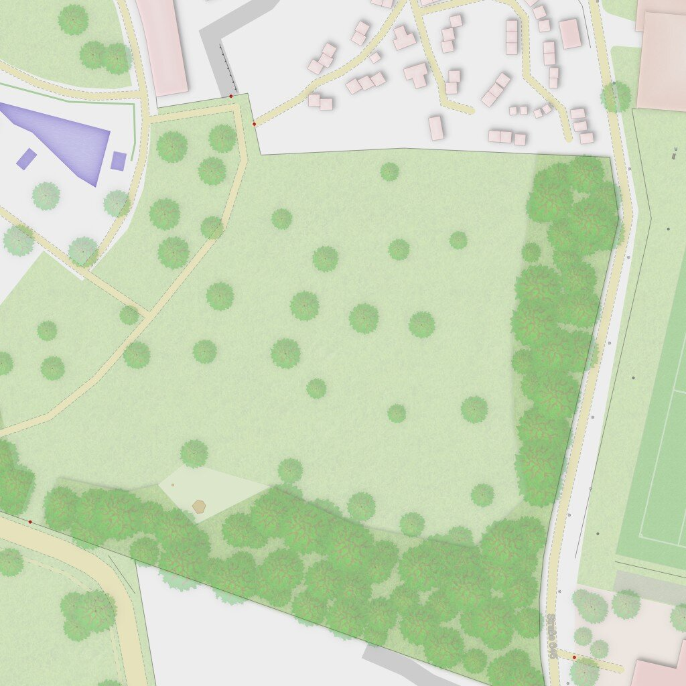
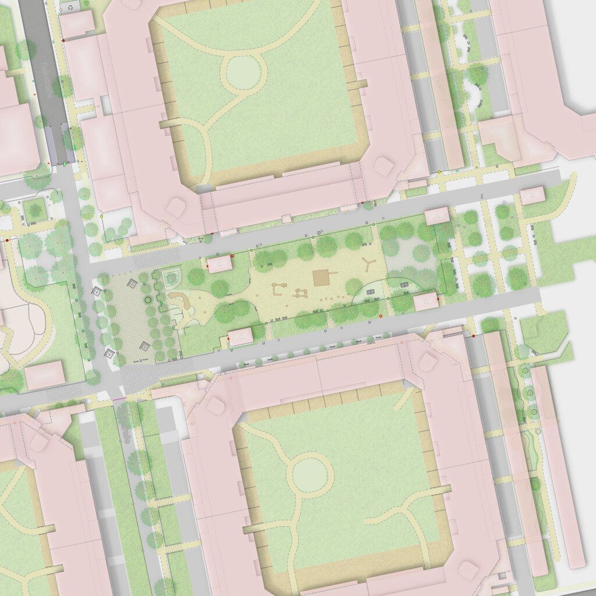

# Test scenes

Four scenes from today's rendering (tiles from 2026-08-01, z19, 4×4 tiles = 1024×1024 px ≈ 190 m). They cover the situations both explorations must handle. Tile ranges are defined in [`../tools/make_scenes.py`](../tools/make_scenes.py).

| Scene | z19 tiles x / y | Why |
|---|---|---|
|  **A — Herrfurthplatz** | 281689–281692 / 172043–172046 | Round square with a church (landmark), street trees, perimeter blocks |
|  **B — Schillerpromenade** | 281691–281694 / 172049–172052 | Promenade with playgrounds (accent test), tree rows, courtyard blocks |
|  **C — Hasenheide edge** | 281682–281685 / 172039–172042 | Solitary trees vs woodland mass, pond, small houses |
|  **D — Courtyard blocks** | 281701–281704 / 172044–172047 | Green courtyards with path figures, pedestrian street with playground |
