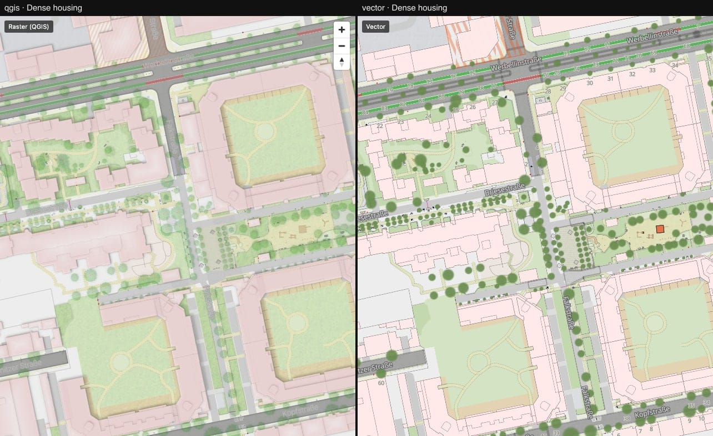
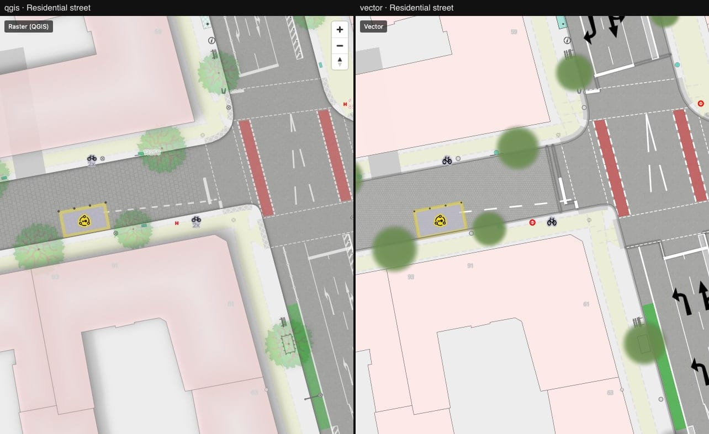

# 00 — Baseline

QGIS raster tiles (left) against the MapLibre vector style (right) on 2026-10-08, before any
renderer patch. MapLibre GL JS 6.0.0, unpatched.

What stands out, roughly by impact:

- **No building shadows.** QGIS draws a soft drop shadow to the south-east of every building;
  the vector map is flat. Gap #1 in [maplibre-style-gaps.md](../../maplibre-style-gaps.md).
- **Tree crowns** are blurred green discs instead of the semi-transparent leaf texture
  ([dense-trees](./dense-trees.jpg)).
- **Road-marking arrows** are black and far too large ([parking-street](./parking-street.jpg))
  — an asset bug (SVG `param(fill)` not substituted, icons squeezed into a square).
- **Buildings** are paler and carry a dark outline that QGIS does not draw; the roof shading
  is missing.
- **Surface textures** (asphalt, sett) are fainter and at the wrong scale away from z18.
- House numbers and street labels are stronger than in QGIS.

| Location | File |
|---|---|
| Intersection, z18 | [intersection.jpg](./intersection.jpg) |
| Dense trees, z18 | [dense-trees.jpg](./dense-trees.jpg) |
| Dense housing, z17 | [dense-housing.jpg](./dense-housing.jpg) |
| Residential street, z19 | [parking-street.jpg](./parking-street.jpg) |
| Playground, z18 | [playground.jpg](./playground.jpg) |
| Park / water / pitches, z17 | [park-water.jpg](./park-water.jpg) |

