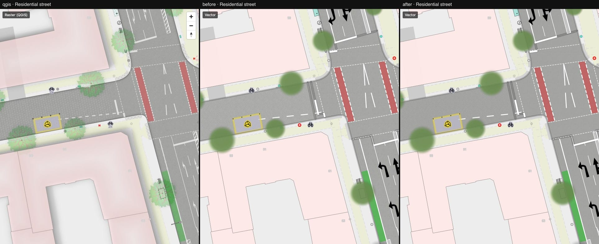

# 01 — `fill-layer-blend: multiply`

First local MapLibre patch ([maplibre-patches.md](../../maplibre-patches.md)). Columns: QGIS ·
vector before · vector after.

What changed:

- New paint properties `fill-layer-blend` / `line-layer-blend` (`multiply`, `screen`, `plus`).
- The surface textures of `highway_area`, `landuse` and `pitch` are now multiplied onto the
  fill colour, as in QGIS, instead of alpha-blended. They are also merged into one layer per
  group (49 layers → 9).

What to look at: the sett and asphalt on the carriageway in
[parking-street.jpg](./parking-street.jpg) and [intersection.jpg](./intersection.jpg).

Honest result: **the visible difference is small.** QGIS draws these textures at 6–12 % alpha,
so multiply versus alpha-over only shifts the texture from "lighter and darker speckle" to
"darker speckle". The value of this step is the mechanism: the patch workflow works end to end
(renderer, style-spec validation, types), and multiply compositing is the building block the
drop shadows need next. The textures still differ from QGIS mainly in scale and rotation
(gap #3), not in blending.

