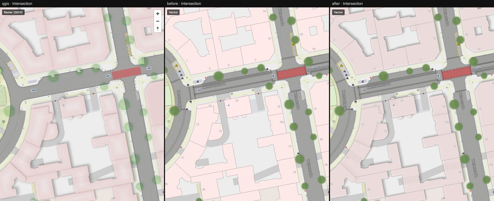
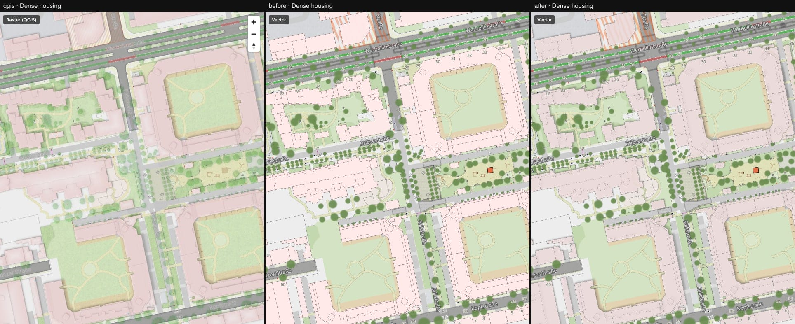

# 02 — `fill-layer-blur`: real drop shadows for buildings

Second local MapLibre patch ([maplibre-patches.md](../../maplibre-patches.md)). Columns: QGIS ·
vector before · vector after.

What changed:

- New paint properties `fill-layer-blur` / `line-layer-blur`: a Gaussian blur of the whole
  layer, done on the same scratch framebuffer as `*-layer-opacity` and `*-layer-blend`.
- `layerShadow()` in `vector/src/style/effects.ts` builds a QGIS dropShadow from it: polygons in
  the shadow colour, offset with `fill-translate`, blurred, multiplied onto the map.
- Buildings now follow the QGIS stack exactly: `building_shade` shadow → building-parts shadow
  → parts at α 0.7 → `roof shape` screened on top. The opaque `building-fill` layer with its
  1 px outline is gone — QGIS has no such layer, and it was the reason roofs were too pale and
  edges too hard.
- The shadow offset angle was wrong (QGIS measures clockwise from north, not counter-clockwise
  from east).

What to look at: courtyards in [intersection.jpg](./intersection.jpg) and
[dense-housing.jpg](./dense-housing.jpg) — soft shadows to the south-east, darker roofs,
shadows of taller parts falling on the ground between buildings.

Measured, not just eyeballed: the brightness profile across a shadow edge matches QGIS within a
few levels (QGIS `aa ae ba c4 cb d3 dd e5 e9`, vector `a0 b0 c0 cb d6 e1 e8 ec`), and the
pixelmatch difference dropped from 12.1 % to 7.1 % (intersection) and 18.1 % to 11.8 % (dense
housing).

Still different from QGIS:

- Roofs have no lighter centre. QGIS draws a Shapeburst gradient (red at the edge, white in the
  middle) per building; we screen one flat colour (gap #8).
- QGIS casts each part's shadow onto the lower parts next to it (sorted by height). A
  layer-level shadow cannot interleave with its own layer, so roof-on-roof shadows are missing.
- Shadows for street furniture, trees and `feature_polygon` still use the old approximation.

