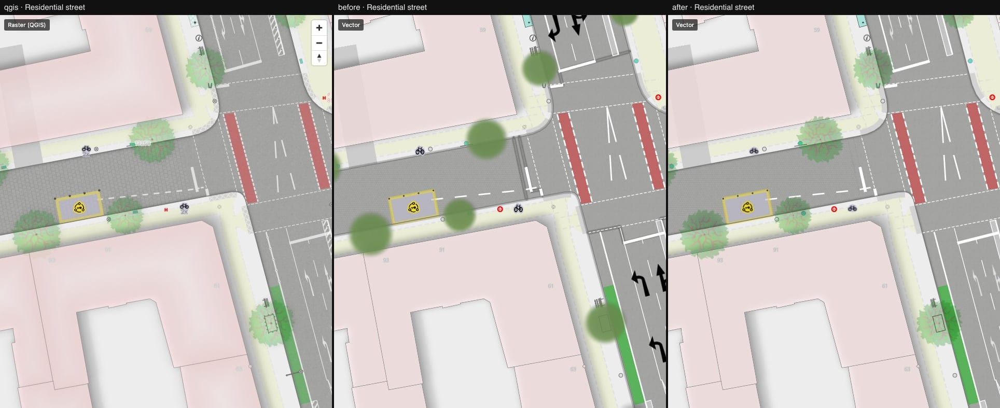
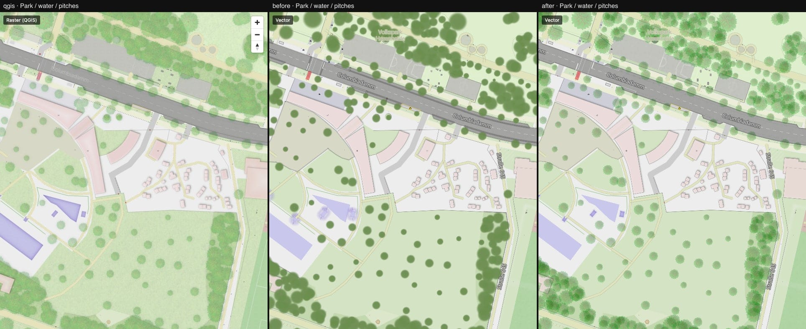

# 03 — Inner shadows, tree crowns, icons

Columns: QGIS · vector after step 02 · vector now.

Renderer patch ([maplibre-patches.md](../../maplibre-patches.md)):

- `fill-layer-blur-mode: inner-edge` — the blurred layer is combined with the unblurred one so
  the colour appears only *inside* the polygon, strongest at the edge. That is a QGIS
  innerShadow. Used for the carriageway edge (`z14`…`z20` layers), water bodies and sandpits.
- Offscreen layers are skipped when no visible tile has features for them.

Style and assets (no patch needed):

- **Tree crowns** use the QGIS leaf textures (`symbols/trees/*.png`), sized by `diameter_crown`
  and rotated, instead of blurred green discs.
- **Icons** are rasterised into a second sprite sheet at build time with their real aspect ratio
  and the QGIS colours (`param(fill)` substituted). Lane arrows were black and three times too
  wide; they are now light and the right size.
- Forest and bridge shadows moved to the blurred `layerShadow`.
- `@2x` textures are resampled from the source images; the sprite build is reproducible.

What to look at:

- [parking-street.jpg](./parking-street.jpg): the hard dark line along every kerb is gone, the
  carriageway edge darkens softly; arrows; tree crowns.
- [park-water.jpg](./park-water.jpg): the park reads like QGIS now.
- [dense-trees.jpg](./dense-trees.jpg): right texture, but see below.

Pixelmatch difference to QGIS, baseline → now: intersection 11.8 % → 3.6 %, residential street
11.4 % → 2.7 %, dense housing 18.1 % → 8.3 %, park 21.4 % → 7.9 %, dense trees 69.5 % → 26.3 %.

Still different from QGIS:

- **Overlapping tree crowns are too dark.** QGIS flattens the crown layer and applies 25 %
  opacity once; MapLibre has no layer opacity for symbol layers, so every crown adds up.
- Road markings are pure white and full strength (QGIS: 67 % layer opacity), dashes too long.
- Street labels and house numbers are stronger than in QGIS.
- Needle-leaved crowns appear only after the tile pipeline is re-run (`leaf_type` was added to
  the export).

