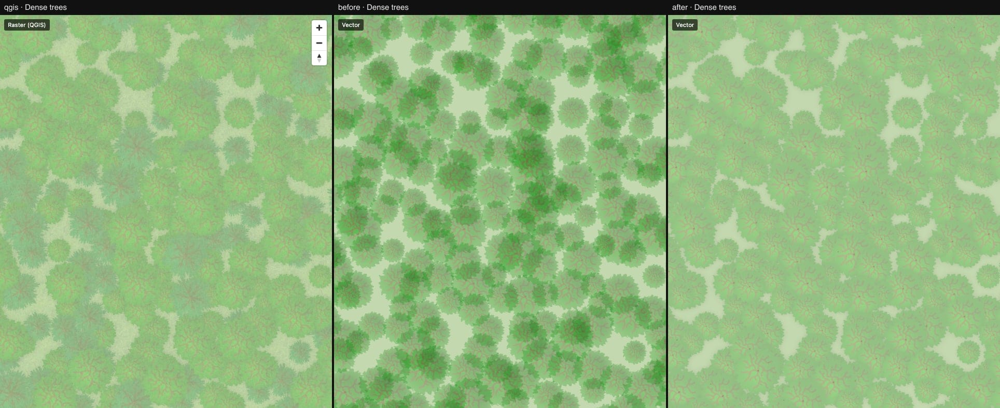
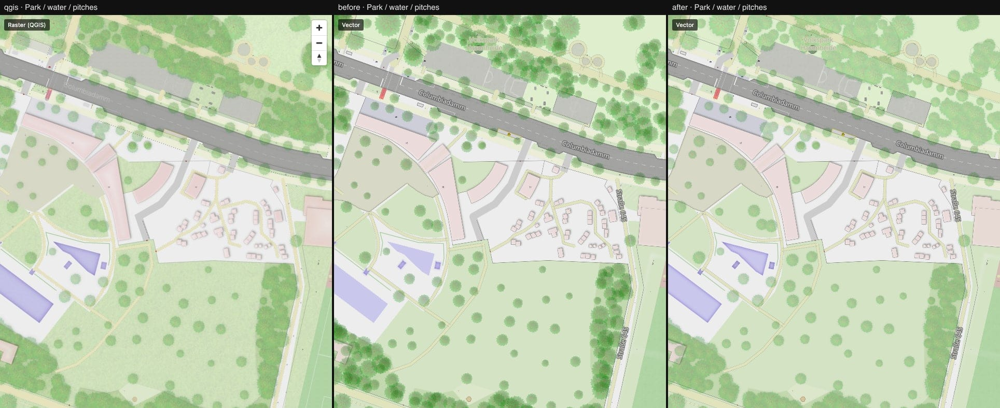

# 04 — Flattened tree crowns, water edges

Columns: QGIS · vector after step 03 · vector now.

Renderer patch ([maplibre-patches.md](../../maplibre-patches.md)):

- `symbol-layer-opacity` — draws a symbol layer opaque into the scratch framebuffer and
  composites it once. QGIS applies the 25 % opacity of the `tree crown` layer to the flattened
  layer; with per-icon opacity every overlapping crown added up and dense stands went dark.

Style and assets:

- The crown drop shadow (black 40 %, blurred) is baked into the crown sprite. Inside the
  flattened layer each crown therefore shades the crowns drawn before it — that is where QGIS
  gets the darker tone in dense stands.
- Swimming pools (`landuse=swimming_pool`) get their QGIS inner shadow. They looked like water
  bodies without an edge.
- Real water bodies follow the QGIS symbol stack: three multiplied inner shadows, a white
  shoreline fade, the water texture, and the blue depth tint (`inner-core` blur mode). There is
  no larger water body inside the current tile extent to show it.

What to look at: [dense-trees.jpg](./dense-trees.jpg) (difference to QGIS 26.3 % → 1.2 %) and
the pools in [park-water.jpg](./park-water.jpg).

Still different from QGIS:

- Lawns have no grass texture and are slightly paler.
- Paths have a thin dark casing that QGIS does not show at this zoom.
- Pool interiors are a little lighter than in QGIS.

