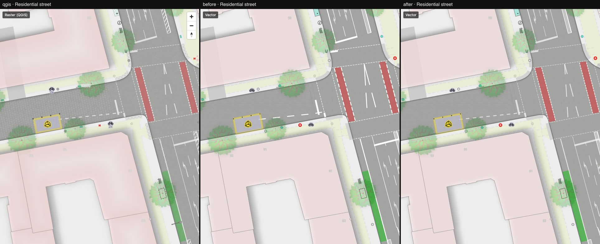

# 05 — Road-marking dashes and opacity

Columns: QGIS · vector after step 04 · vector now. No renderer patch — this was a port bug.

What was wrong:

- **Dash lengths scaled with the line width.** `line-dasharray` is measured in line widths. The
  port converted the QGIS dash lengths (ground metres) for a 0.12 m line and reused that array
  for every marking, so a 0.25 m cycle-lane edge line got dashes twice as long as in QGIS and a
  0.5 m line four times.
- Markings were pure white at full strength; QGIS draws the layer at 67 % opacity.

What changed:

- `line-dasharray` is now data-driven: a `match` on the feature's `dasharray` and `width`
  yields the array for that width, so dashes keep their ground length. This also folds four
  layers per marking role into one (1265 → 1193 style layers).
- `line-opacity: 0.67` on road-marking lines.

What to look at: the dashed edges of the red cycle lanes and the lane lines in
[parking-street.jpg](./parking-street.jpg). Difference to QGIS there: 2.6 % → 1.8 %.

## How MapLibre dashes differ from QGIS (for later)

Checked while fixing this, because zoom-dependent dashes have a bad reputation:

- **Scale across zoom is fine for us.** MapLibre scales the pattern with the line width at the
  *integer* zoom and stretches it in between. With widths defined in ground metres (exact
  base-2 interpolation) that is continuous: dashes keep a constant ground length at every zoom,
  like QGIS map-unit dashes.
- **Dash phase restarts at every tile edge.** Vector tiles carry clipped line pieces without
  their distance along the original line, so a dash can be cut short or doubled where two tiles
  meet. QGIS renders the whole line. Fix options: a renderer patch that derives the phase from
  world coordinates for straight segments, or exporting a `line-progress`-like attribute.
  Not done — at the compare locations it is not noticeable.
- **No dash alignment to corners or line ends.** QGIS can do this, but the project does not use
  it (`align_dash_pattern = 0`, `tweak_dash_pattern_on_corners = 0`), so there is nothing to match.
- **Dash arrays cannot be computed with arithmetic**, only selected (`match` → `literal`). Every
  width that occurs in the data has to be listed (`ROAD_MARKING_WIDTHS_M` in
  `vector/src/style/layers/detail.ts`); other widths fall back to the 0.12 m table.

