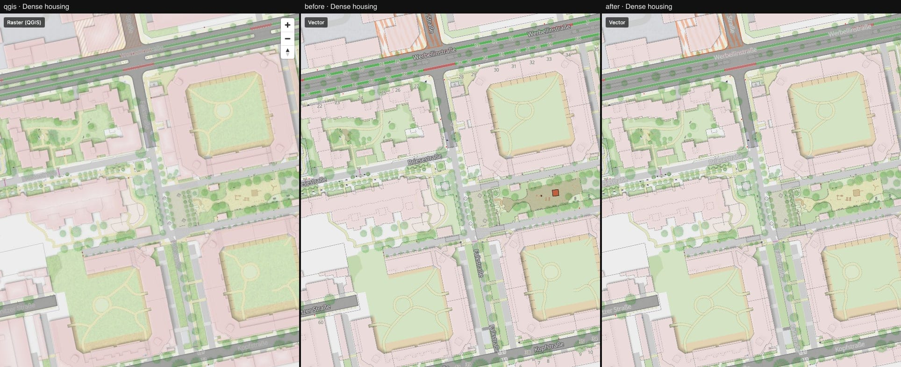
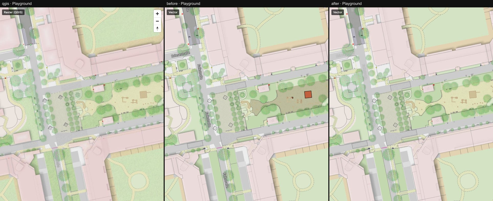

# 06 — Scale gates, quiet labels, playground

Columns: QGIS · vector after step 05 · vector now.

Port bugs fixed (style only, plus one shader fix in the patch):

- **Every QGIS scale gate was one zoom level late.** The port converted scale to zoom with
  `log2(559082264 / scale)`. That is the zoom of QGIS's 256 px tiles; MapLibre counts 512 px
  tiles, so its zoom is one lower. `scaleToZoom()` in `vector/src/style/metres.ts` is now the
  one place that does this. Street names appear at z16.2–18.2 instead of z17–19, house numbers
  from z18.2, landuse and water labels end at z17.2, the dog-park pattern starts at z15.6.
- **Street labels** use the QGIS colours (#dddddd on a #a8a8a7 buffer) instead of white on dark
  grey. They are meant to be quiet.
- **Tree reference numbers** only below 1:750 (z ≥ 18.6), in the QGIS colours. They cluttered
  every street at z17.
- **Dark playground:** the inner-shadow shader shaded the whole polygon when the layer had a
  per-feature opacity below 1 (sandpit: 20 %). The blurred alpha is now taken relative to the
  source alpha.
- **Climbing frames** were solid orange with a black outline; QGIS draws the playground sand
  colour with a faint cross-hatch.
- **Coloured surface markings** (green/red cycle lanes) use the QGIS colour names at 45 % × the
  67 % layer opacity instead of a custom palette at 45 %.
- Place labels for suburb/town/city were dead layers below the archive's minimum zoom; removed.

What to look at: street names and the green cycle lanes in
[dense-housing.jpg](./dense-housing.jpg), the sand area in [playground.jpg](./playground.jpg).

Difference to QGIS, step 05 → now: intersection 3.5 % → 2.7 %, dense housing 7.6 % → 5.2 %,
playground 8.4 % → 3.9 %.

Still different from QGIS:

- Lawns and courtyards have no grass texture (QGIS: `grass.png`, pixel-sized).
- The construction hatch is stronger and coarser than in QGIS.
- Thin dark lines on building parts and path edges are crisper than in QGIS.

