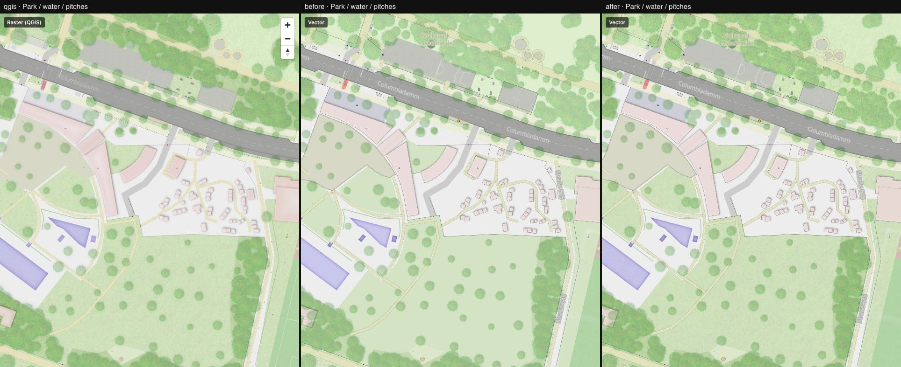

# 07 — Landuse textures

Columns: QGIS · vector after step 06 · vector now. Style only.

QGIS gives most landuse classes a faint texture on top of the fill colour: `grass.png` on
parks, lawns, gardens and woods, `gravel.png`, `sand.png`, `flowerbed.png`, `water.png` on
pools, `woodchips.png`. The port only had the `surface=*` textures, so green areas were flat.

All classes share one pattern layer (`LANDUSE_CLASS_PATTERNS` in `vector/src/style/colors.ts`,
built by `surfacePatternLayer`), with `fill-pattern` and `fill-opacity` selected per class.

What to look at: the lawns in [park-water.jpg](./park-water.jpg) (difference to QGIS
6.1 % → 3.2 %) and the courtyards in [dense-housing.jpg](./dense-housing.jpg).

