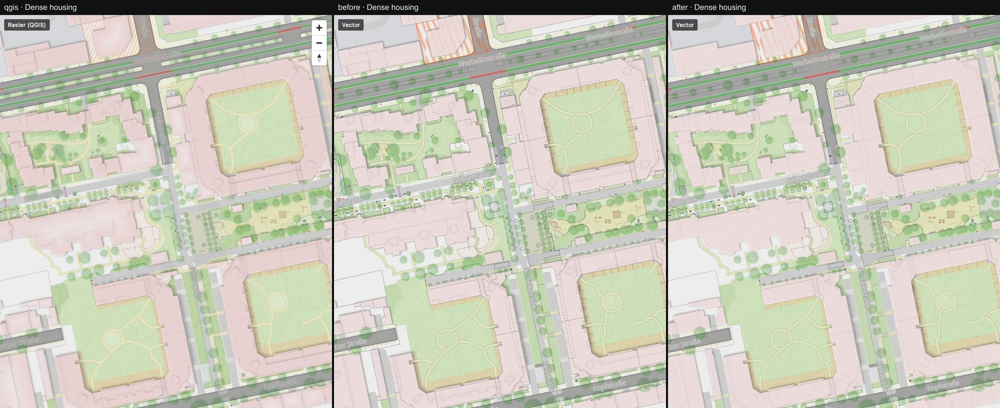

# 08 — Sub-pixel lines fade instead of staying sharp

Columns: QGIS · vector after step 07 · vector now. Renderer patch
([maplibre-patches.md](../../maplibre-patches.md)).

The problem: thin dark lines along building parts, roof edges and paths looked crisp and
pixelated, where QGIS shows them barely or not at all.

The cause is in MapLibre's line shader. A line narrower than one pixel is drawn as a ramp
about one pixel wide that peaks at 50 % alpha or more, however thin the line is. A 0.1 px line
(a 0.04 m roof edge at z17) therefore puts down about 0.3 px of ink. QGIS antialiases by
coverage: 0.1 px of ink — a faint hint.

The patch scales the alpha of lines below one device pixel by `w / (w/2 + 0.5)²`, which makes
the ink equal the true width. Lines of one pixel and more are untouched, and so are blurred
lines and lines with a gap width.

What to look at: the building-part edges in [dense-housing.jpg](./dense-housing.jpg) and
[intersection.jpg](./intersection.jpg). Difference to QGIS: dense housing 5.2 % → 4.4 %,
intersection 2.7 % → 2.3 %, park 3.2 % → 2.7 %.

This is a global change: every sub-pixel line in the style gets fainter. That is what the QGIS
reference does, but check thin lines you rely on at low zooms.

