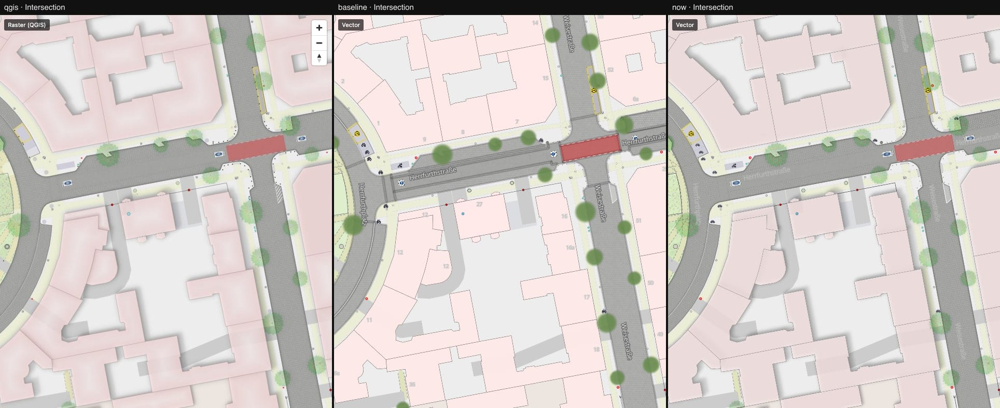
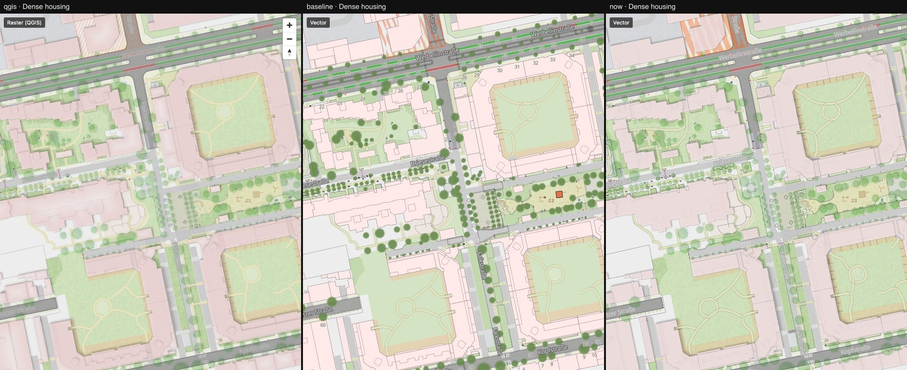
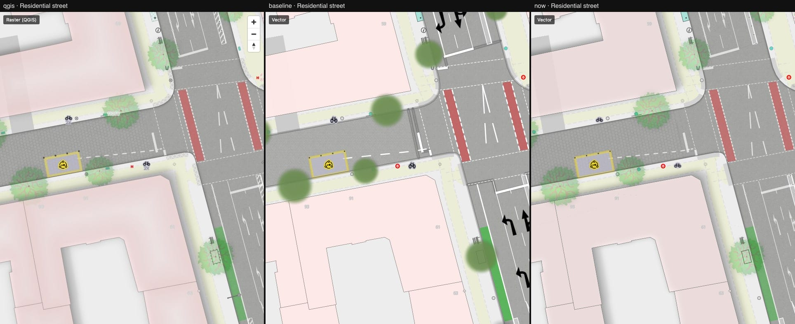
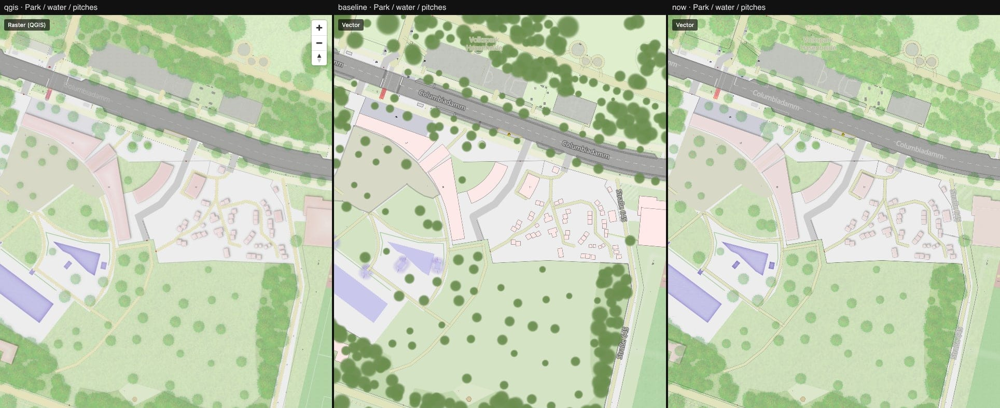
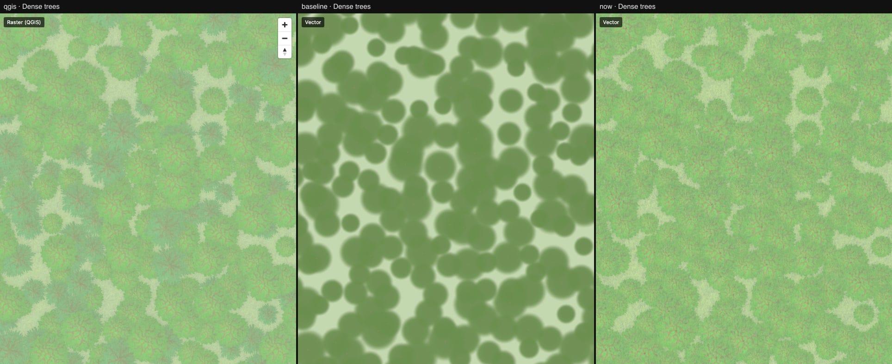
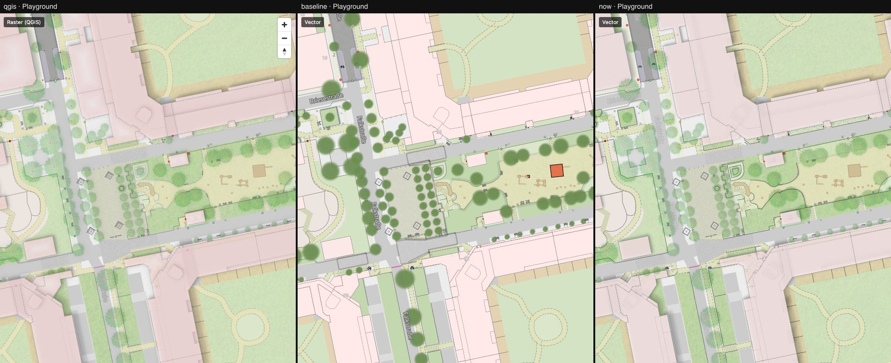

# 09 — Baseline versus now

Columns: QGIS · vector at the start of this work (step 00) · vector now (after step 12).
No change of its own; this folder is the summary view and is regenerated when a later step
moves the numbers.

| Location | Difference to QGIS at the start | Now |
|---|---|---|
| Intersection, z18 | 11.8 % | 2.7 % |
| Dense trees, z18 | 69.5 % | 1.6 % |
| Dense housing, z17 | 18.1 % | 4.7 % |
| Residential street, z19 | 11.4 % | 1.9 % |
| Playground, z18 | 17.8 % | 3.8 % |
| Park / pools, z17 | 21.4 % | 3.2 % |
| Courtyard furniture, z19 (added in step 10) | 6.5 % | 2.9 % |
| Sett street, z20 (added in step 12) | — | 2.3 % |

The number is the share of pixels that pixelmatch flags (threshold 0.1) between the QGIS raster
pane and the vector pane; the map controls in the QGIS pane account for about 0.2 %.

What made the difference, roughly in order of effect:

1. Real drop shadows and the QGIS building stack (`fill-layer-blur`, step 02).
2. Tree crown textures, flattened before fading (`symbol-layer-opacity`, steps 03–04).
3. Inner shadows along carriageways and water (`fill-layer-blur-mode`, step 03).
4. Port bugs: scale gates one zoom late, dash lengths, icon aspect and colours, label
   colours, layers QGIS does not have, parking spaces as carriageway (steps 03, 05, 06, 10).
5. Landuse textures (step 07), sub-pixel line ink (step 08), ground-sized rotated textures
   (step 12), marker rows (step 11), multiplied surface textures (step 01).

The score understates two steps: thin lines (step 08) and texture rotation (step 12) look
clearly closer but hardly move it, because QGIS output is softer (resampled, JPEG) and the
textures are only 6–12 % opaque.

