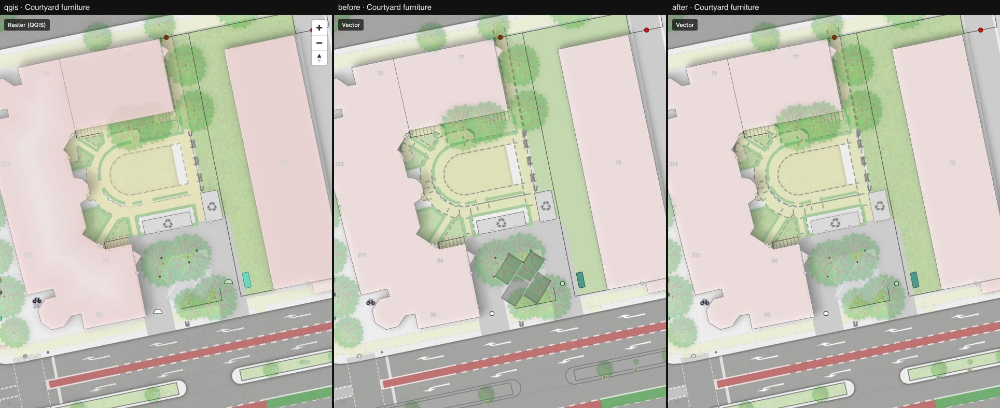

# 10 — Shadows as a layer property, heavy outlines and stray fills removed

Columns: QGIS · vector after step 08 · vector now. New compare location
`courtyard-furniture` (z19) with waste-disposal enclosures, a street cabinet and parking
spaces under trees.

Renderer patch ([maplibre-patches.md](../../maplibre-patches.md)):

- `fill-shadow-color`, `fill-shadow-opacity`, `fill-shadow-blur`, `fill-shadow-translate` — a
  fill layer casts its own drop shadow. The layer is rendered to the scratch framebuffer once;
  its alpha is blurred, tinted, shifted (map-anchored, so it follows rotation) and multiplied
  onto the map, then the layer itself is composited from the same framebuffer. Before, a shadow
  needed a second style layer with the same filter.
- Used for the QGIS drop shadows of street furniture: shelters, toilets, recycling and
  waste-disposal enclosures (blur 2, offset 1, black 10 %), chimneys and masts (offset 0.5),
  piers (blur 1, #232323 20 %). `shadowPaint()` in `vector/src/style/effects.ts` converts the
  QGIS values.

Port bugs this location exposed:

- **Parking spaces were painted as carriageway** (the dark rectangles under the trees). QGIS's
  `highway_area` layer has rules for 26 `area:highway` values; `parking_space`,
  `traffic_island` and `platform` are not among them and are not drawn by it.
- **The carriageway inner shadow applied to every `highway_area` polygon.** QGIS restricts it
  to carriageway classes and the parking lanes belonging to them.
- **Every furniture polygon had a full-strength 1 px outline** (`fill-outline-color`) on top
  of its metre-width outline line. The street cabinet looked dark teal instead of cyan.
- `scrub` had no grass texture (it lives in a separate QGIS layer).

Also: the screenshot script now does a warm-up load, so the first location is no longer
captured mid-reload after a source edit.

What to look at: [courtyard-furniture.jpg](./courtyard-furniture.jpg) — difference to QGIS
6.5 % → 2.9 %. The furniture shadows themselves are subtle in QGIS too (10 % black); the
visible change comes from the bug fixes.

Still different at this location: the dashed path edges are heavier than in QGIS, and QGIS
draws a half-disc symbol where we draw a circle.

