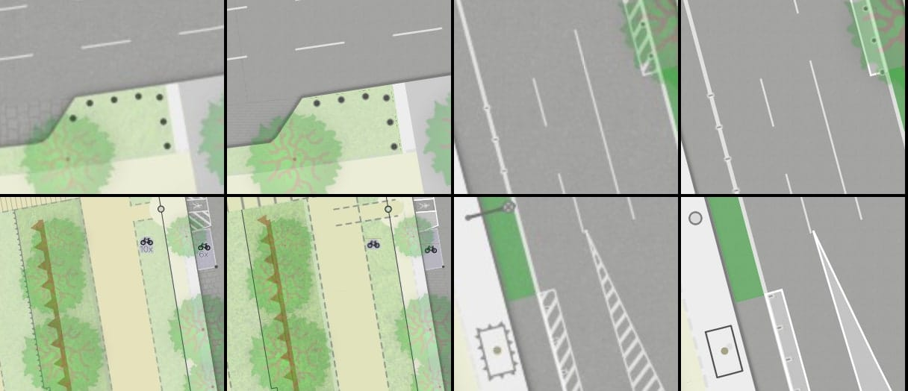

# 11 — Marker rows that rendered nothing

One image, four spots, each as a pair QGIS · vector (now). Style and sprite only.

Top row: bollard row (z20, 52.48002 / 13.41990) · separation bollards on a lane line (z20,
52.47640 / 13.42665). Bottom row: embankment ticks (z19, 52.47505 / 13.41885) · separation
panels next to a barred area (z20, 52.47570 / 13.42690).

What was wrong: several QGIS marker lines were ported as text layers using the characters
▲ ▼ ▶ ●. The glyph files for our fonts do not contain these characters, and MapLibre does not
fall back to drawing them locally, so the layers rendered **nothing**: no bollard rows, no
embankment ticks, no separation bollards, no sharks teeth, no guard stones.

What changed:

- Small shape icons (`style/symbols/shapes/*.svg`) are packed into the symbol sprite and placed
  along the lines with the QGIS size, colour and interval. Palisades (0.2 m posts every 0.2 m)
  are a round-capped dashed line instead.
- Values now come from the QGIS project: bollards 0.4 m every 1.5 m (the port assumed 2 m),
  embankment ticks #965220 at 50 % layer opacity, separation bollards with the light outline at
  67 %.
- Marker lines need `text-size: 0.01` in the layout (`markerLineLayout` in
  `vector/src/style/sprite-icons.ts`): MapLibre otherwise widens any `symbol-spacing` below
  about 57 px, which made close-set markers impossible.

Confirmed against QGIS at the four spots above. **Not verified**, because the current tile
extent has no such features: sharks teeth, guard stones, peaks, flex posts.

Still different (visible in the bottom-right pair, and unrelated to this step): barred areas
have no diagonal hatching (gap #4, parametric pattern fills), and street lamps are a plain
circle instead of QGIS's lamp symbol.

Open: marker phase along the line (`offset_along_line`) cannot be set and restarts at tile
edges; palisade colour by height needs the `height` column in the export; retaining-wall ticks
are not ported.

