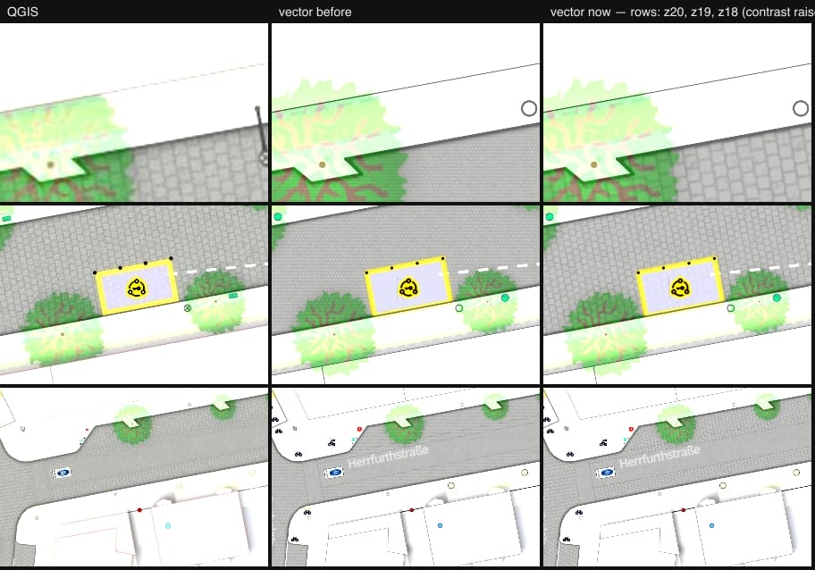

# 12 — Surface textures keep their ground size and follow the street

One image: QGIS · vector before · vector now, at z20 (new compare location `sett-street`),
z19 and z18. Contrast is raised so the faint textures can be judged.

Renderer patch ([maplibre-patches.md](../../maplibre-patches.md)):

- `fill-pattern-reference-zoom` — a pattern keeps the ground size it has at that zoom.
  Stock MapLibre gives a pattern the same *pixel* size at every integer zoom, so its ground
  size halves with each zoom level: sett stones were four times too small at z20 and too large
  below z18. QGIS draws these textures at a fixed ground width (sett 11 m, asphalt 6 m, paving
  stones 4.5 m, concrete 3 m per image).
- `fill-pattern-rotate` — rotates the pattern per feature (data-driven, degrees clockwise).
  QGIS rotates sett and concrete by the street's `direction` and paving stones by
  `direction + 45`.

Style and assets:

- `surfacePatternLayers()` splits each texture table into ground-sized textures (reference
  zoom + rotation) and screen-sized ones (grass, sand, gravel — QGIS unit Pixel).
- Ground textures are baked for z19 instead of z18 (`TEXTURE_REF_ZOOM`), so they are sharp at
  z19, magnified 2× at z20 and reduced 2× at z18.

What to look at: stone size and the direction of the courses in the top row (z20); the same
street section at z19 and z18 below.

Known limits:

- **Rotated textures restart at tile edges.** A rotated pattern cannot be anchored to the
  global pixel grid with 32-bit floats, so the rotation pivots on each tile's origin. Within one
  road polygon the stone courses can jump where two tiles meet (and when the tile zoom
  changes). Unrotated textures (asphalt) are seamless. At 6–12 % opacity I could not spot a
  seam at the compare locations; it will be visible if you look for it.
- Below z18 the textures are reduced without mipmaps and turn into fine noise — close to what
  QGIS shows at those scales, but not filtered as cleanly.
- `sett:length` (smaller stones → 6 m / 8.5 m image width) is ignored; the data has no values.
- `pitch surface` does not rotate sett in QGIS; the shared table rotates it.

