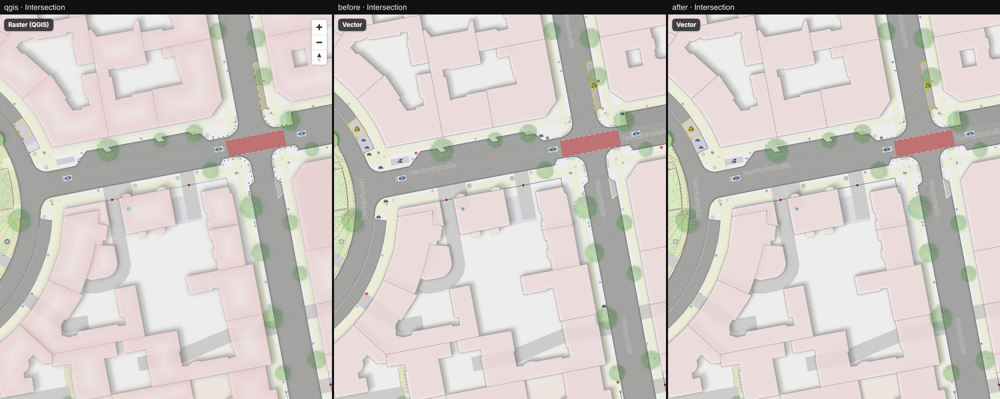
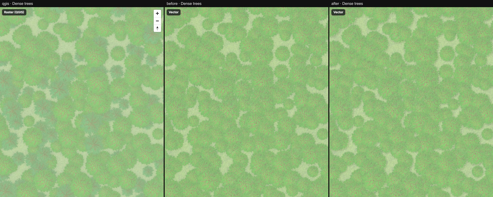
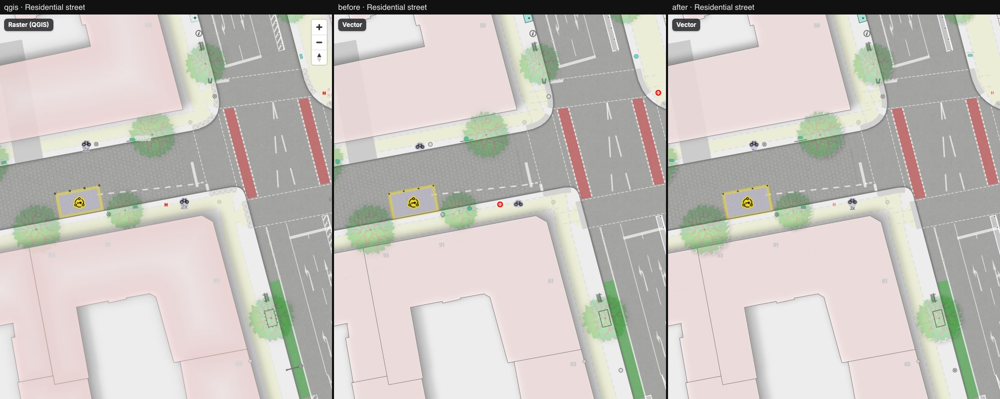
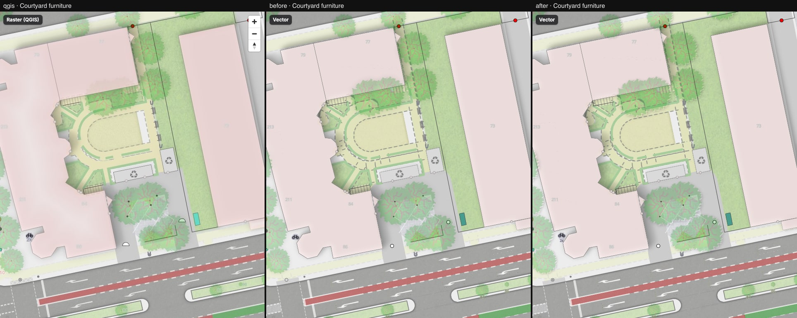
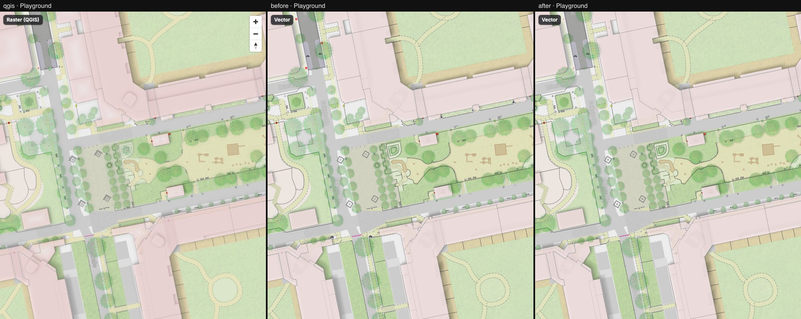
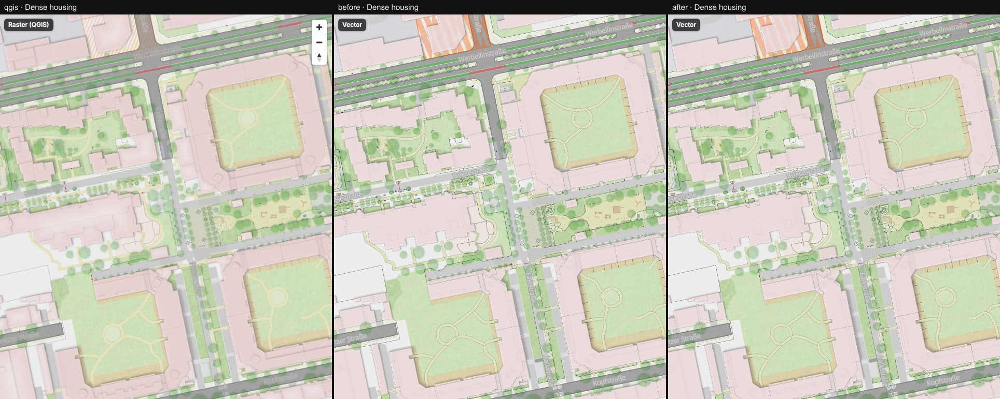
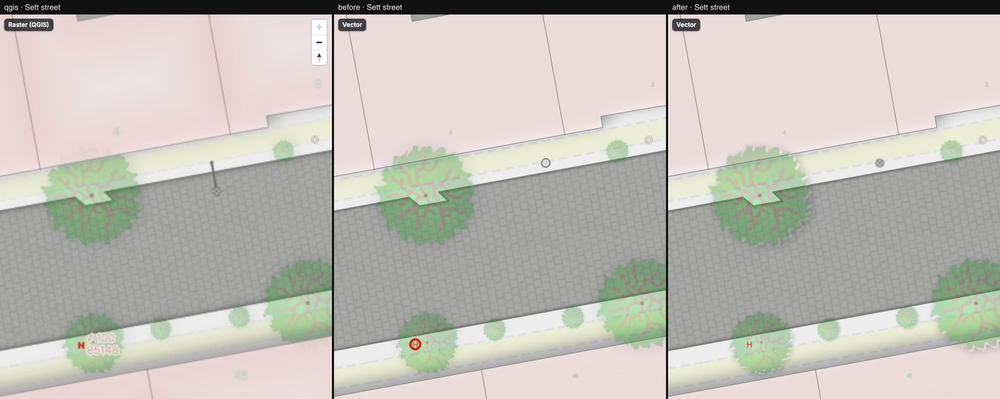
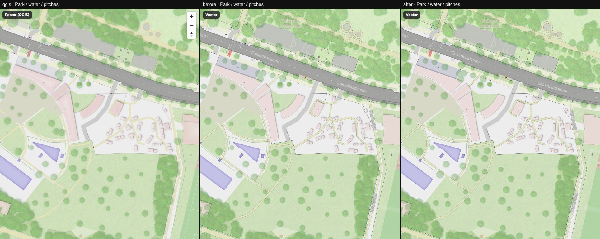

# 13 — Tree crowns and street icons

Columns: QGIS · vector before (step 12, commit `8a39c33`) · vector after (this step). Eight
compare locations; the QGIS pane is the same in every row.

Tree crowns (sprite, `vector/scripts/build-sprite.ts`, `TREE_SHADOW` in `sprite-icons.ts`):

- The crown PNG is resampled with a Mitchell kernel instead of Lanczos. QGIS downsamples the
  678 px leaf texture smoothly, so its branches read softer and paler; the Lanczos version was
  crisper and more brown.
- The baked drop shadow is narrower (Gaussian sigma 0.05 of the crown width instead of 0.15)
  and is knocked out under the crown silhouette, as the Rust renderer does. On dense trees the
  blur width mattered: sigma 0.15 scored 3.22 % (the same as no shadow on the regenerated
  sheet), 0.09 scored 2.19 %, and 0.05 with the Mitchell kernel scored 1.88 %. A sigma of 0.02
  scored the same as no shadow at all, so 0.05 is the narrowest that still shows.
- Crown mean colour at the sampled points (crown centre over pale ground, crown over pavement)
  is within 1–2 levels of QGIS. What still differs is the texture and the grey-blue shade that
  QGIS puts into dense stands ([dense-trees](./dense-trees.jpg)).

Street furniture (`vector/src/style/layers/furniture.ts`, `style/symbols/shapes/`):

- **Fire hydrants**: QGIS draws a red ring only for pillar, pipe and wall hydrants; every other
  hydrant is a red "H" glyph from 1:1500 and closer. The vector drew the ring for all of them
  (the red rings in [parking-street](./parking-street.jpg)).
- **Bicycle parking**: the QGIS rule "bicycle/two wheeled parking (symbol)" only applies at
  1:750 and closer, so the bicycle is now hidden at z17–18 as in QGIS. The icon sits 0.4 m above
  the point (QGIS `offset 0,-0.4`) and the capacity ("2x") is drawn below it.
- **Boxes instead of circles**: clock, parking tickets and charging station are squares; street
  cabinet and grit bin are half squares (`square.svg` is new; `half_square.svg` draws the top
  half of the box, where it drew the right half, which made the cabinet too tall).
- **Plain street lamp**: a grey disc with a grey X (QGIS `circle` + outline-only `cross2`),
  not a plain disc. Compound lamps (bent mast, wall) are still simplified.

Harness numbers (`bun run screenshots`, pixelmatch threshold 0.1, share of differing pixels):

| Location | Before | After |
| --- | ---: | ---: |
| Intersection, z18 | 3.08 % | 3.02 % |
| Dense trees, z18 | 1.61 % | 1.88 % |
| Dense housing, z17 | 5.21 % | 5.22 % |
| Residential street, z19 | 2.50 % | 2.43 % |
| Playground, z18 | 3.34 % | 3.35 % |
| Courtyard furniture, z19 | 3.42 % | 3.42 % |
| Sett street, z20 | 2.42 % | 2.38 % |
| Park / water, z17 | 3.31 % | 3.40 % |

These numbers do not show the change, and the dense-trees row is not a regression of the trees.
Regenerating the symbol sheet alone (same crowns, no shadow, Lanczos) moved dense trees from
1.61 % to 3.22 %, while the crops looked the same. Sprite packing moves every image in the
MapLibre atlas, including the ground textures, and the pixelmatch residual on textured ground
is sensitive to that. Treat ±1.5 points as noise for any change that touches the symbol sheet;
judge trees and icons by the crops.

Still different from QGIS (not in this step):

- Street names are drawn at z18 in the vector and not in QGIS
  ([intersection](./intersection.jpg)).
- Ground between the crowns is bluer and paler in QGIS by about 10 levels, so the trees sit on
  a different ground colour.
- The hydrant "H" is a regular weight glyph; QGIS uses a bolder face.
- The tree `ref` label that QGIS shows at z19 is not drawn (the label layer is gated at 1:750).
- Capacity labels use a fixed 8 px size, not the QGIS label settings. Cargo bikes use the 1.8 m
  offset.
- Road-marking hatching and chessboards stay flat (gap #4 in the style gaps).

