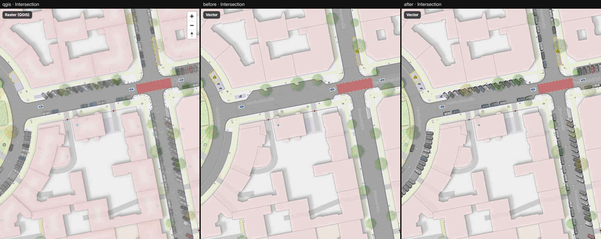
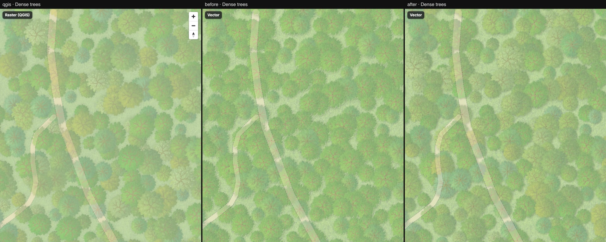
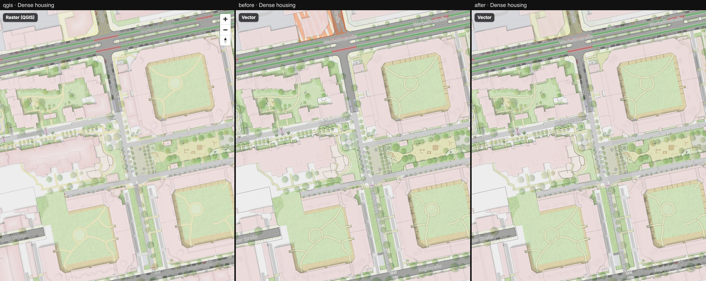
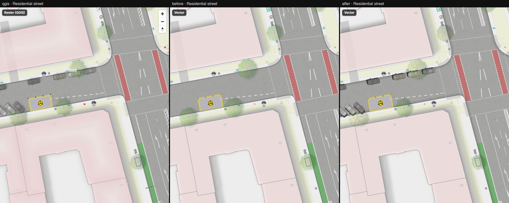
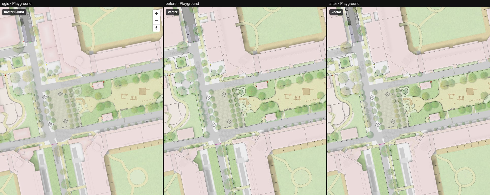
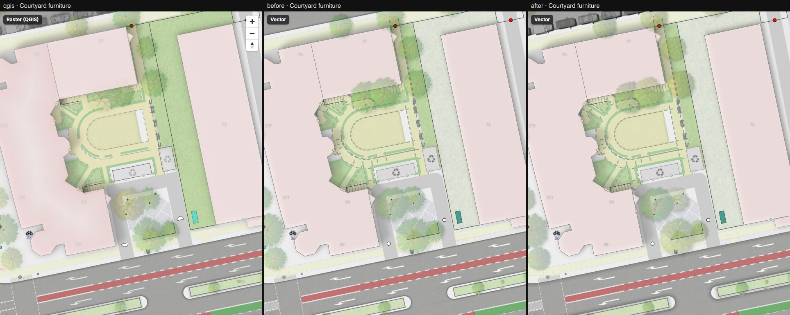
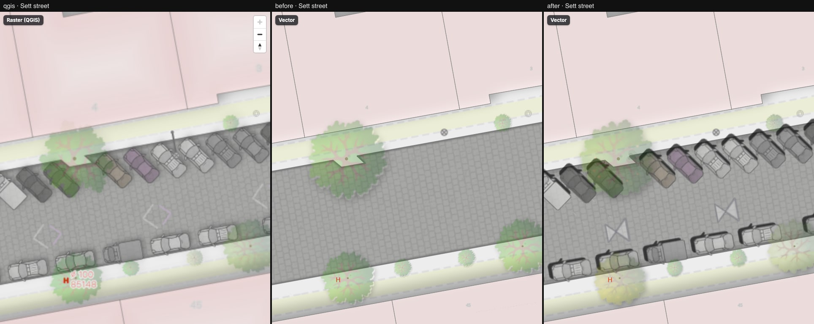
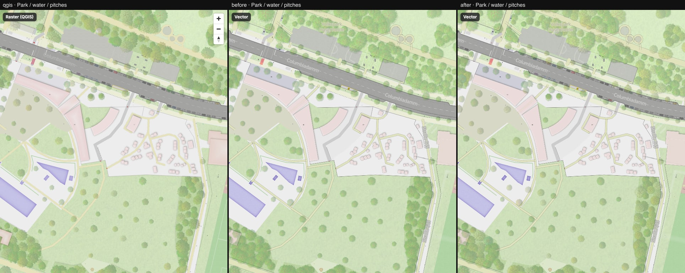

# 14 — New QGIS style: parked cars, tree shrubs, kerbs, one-way arrows

Columns: QGIS (new style, `style/strassenraumkarte.qgz` after main 05991fe) · vector before
(step 13) · vector after (this step). Eight compare locations, pixelmatch threshold 0.1.
The QGIS pane is the same in every row. Gap list: [parity note](../../parity/2026-10-16-after-main-rebase.md).

| Location | Before | After |
| --- | ---: | ---: |
| Intersection, z18 | 5.79 % | 4.33 % |
| Dense trees, z18 | 4.31 % | 4.12 % |
| Dense housing, z17 | 5.79 % | 4.41 % |
| Residential street, z19 | 3.10 % | 2.69 % |
| Playground, z18 | 3.40 % | 3.11 % |
| Courtyard furniture, z19 | 7.89 % | 7.58 % |
| Sett street, z20 | 8.91 % | 5.03 % |
| Park / water, z17 | 3.99 % | 3.79 % |
| **Mean** | **5.40 %** | **4.38 %** |

The "before" column is the step-13 output measured against the new QGIS tiles (the parity note
records the same 5.40 %). The score is pixelmatch on a 1280×800 capture, so judge by the montages.

## What changed

**Parked cars** (`street_parking_point`, export in `vector/layers.ts`, `streetParkingLayersForBucket`
in `src/style/layers/detail.ts`). The QGIS `street parking (<= z17)` layer has no shadow and the
`(> z17)` layer adds one, so there are two symbol layers split at 1:2000 (z17.2). Both use layer
opacity 0.67 (`symbol-layer-opacity`), width 2.4 m (`iconSizeFromMetres`), and the angle from the
feature. The SVG fill is the feature `colour`, which MapLibre cannot tint, so each car type is
baked once per colour (13 colours in the data, grey default). The shadow is baked into the
sprite and rotates with the car. `build-sprite.ts` now takes a shadow angle (QGIS offset angle).

**Tree crowns** (`tree` export from z15, `treeLayers` in `detail.ts`, `crownIconExpression`).
QGIS draws crowns and trunks at every zoom, so the export starts at z15 and the trunk radius
uses metre interpolation instead of a z17-clamped stop pair. All 19 broadleaved, 6 needleleaved
and 6 shrub variants are packed; the variant comes from `ABS(osm_id) % 1000` (QGIS `rand(…, "tid")`
cannot be reproduced). Shrubs use `shrub01–06`.

**Kerbs** (`kerb` export, `kerbLayersForBucket`). The kerb line and its shade moved from
`barrier_way` (z17) to their own source-layer from z15, as QGIS does. The shade (Lineburst,
0.8 m fading, offset 0.4 m, not for `kerb=flush`) is two stacked offset bands, peak ≈ 0.13. The
`highway_area` blur bands in `streets.ts` are removed (QGIS no longer has them).

**One-way arrows** (`highway_oneway`, `highwayOnewayLayersForBucket` in `streets.ts`). Arrowheads
every 12 m, sized 2.5 m / 1.5 m (service) / 1 m (cycleway, footway, path), reversed where
`oneway:bicycle = no`, bicycle symbol every 20 m on cycleways. QGIS draws these as pale chevrons,
not the red fill of the symbol definition, so the packed arrowhead is a light tint with a grey edge.

**Tunnel entrances** (`tunnel_entrance`, `tunnelEntranceLayersForBucket`). QGIS filters
`type = 'road'`; the extract only has `path` and `service` tunnels, so the layer is empty here and
the shade is only a flat approximation of the GradientFill. The outline is not drawn.

**Landuse and features**:
- `construction` follows QGIS: yellow `#dee553` fill and dark 67° hatch (line distance 2.6 m, width
  1.2 m) at layer opacity 0.2, orange edge at 0.2. The old orange hatch was too strong.
- `schoolyard` has its QGIS colour (`#e1e3bd`).
- `scrub (> z16)` and `scrub (<= z16)` have identical symbols in QGIS; the split is a no-op.
- `traffic_calming` bump and hump are packed (3 m, angle = direction, symbol alpha 0.2).

**Not done, on purpose**: `gantry` (no rows in the extract); `commercial` and `industrial`
(no QGIS category, so QGIS draws nothing for them, while `landuse-fill` still paints them grey);
the cycle barrier rule was left as it was.

## Remaining gaps

- The arrows are drawn on every one-way carriageway. QGIS skips those with `turn:lanes`, which
  the `highway_oneway` table does not carry; that shows on turn-lane streets such as the sett street.
- Car colours outside the 13 in the data fall back to grey. Car shadows and crown variants are
  fitted by eye, not measured.
- Sprite weight: `strassenraumkarte-symbols@2x.png` grew from 0.2 MB to 2.8 MB (cars ×168 and
  crown variants ×31 with their shadows). The palette encoding would shrink it, but the marker
  sheet is RGBA on purpose.
- Tree-crown texture and the grey-blue ground in dense stands still differ from QGIS (see
  [13](../13-trees-and-street-icons/README.md)). Courtyard furniture is still the worst location
  and has not been examined in this step.
- Tactile paving is a grey line; QGIS draws crosses (`cross2`) along the kerbs.

